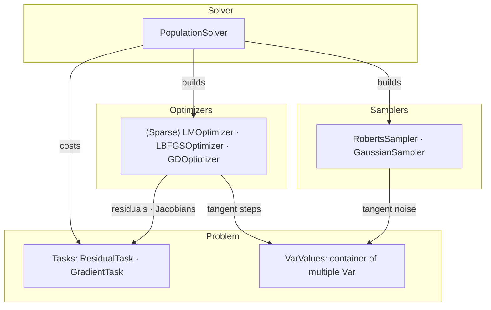
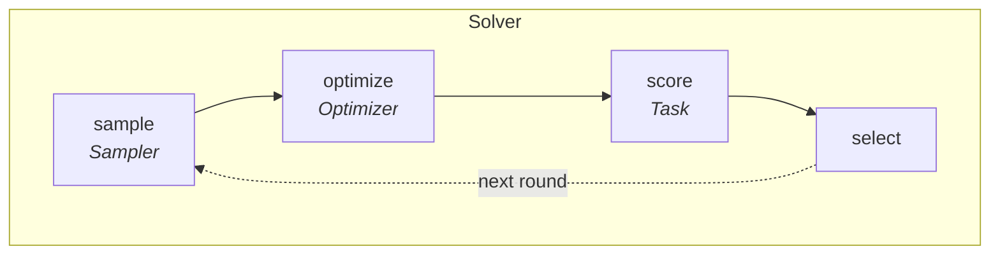
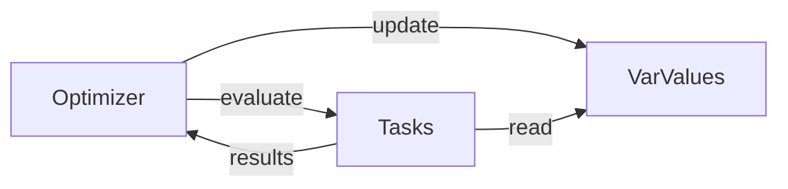

# Optimization

`robokit.opt` solves batched nonlinear optimization problems on the GPU. Variables live on
manifolds, costs come from `robokit.terms` (least-squares residuals or general cost
gradients). IK, motion planning, retargeting, hand-eye calibration, grasp synthesis build
on it.

## Overview

Three parts: a **solver** keeps a population of candidates per problem; an **optimizer**
moves each candidate; a **sampler** draws the tangent noise applied to them.



One round over the population:



- **sample**: a sampler moves each candidate by the last scores, then draws new ones around it.
- **optimize**: the optimizer moves every candidate toward lower cost.
- **score**: the tasks cost every candidate.
- **select**: keep the best candidates per problem.

Each method is a schedule over these four. Multi-candidate LM: optimize, score, select. MPPI: sample,
score. ES: sample, score, select.

```python
# docs: hide
import numpy as np
import warp as wp
from robot_descriptions.loaders.yourdfpy import load_robot_description
from robokit.robo import Robot

device = "cpu"
robot = Robot.load(load_robot_description("panda_description"))
q_init = np.mean(robot.spec.actuated_joint_limits, axis=1).astype(np.float32)[None]
from robokit.lie.se3 import SE3Var
from robokit.opt.lbfgs_optimizer import LBFGSOptimizer
from robokit.opt.lm_optimizer import LMOptimizerConfig
from robokit.opt.population_solver import PopulationSolver, PopulationSolverConfig
from robokit.opt.var_values import VarKey, VarValues
from robokit.terms.dense.configuration_task import ConfigurationTask
from robokit.terms.dense.frame_task import FrameTask
from enum import Enum


class Key(Enum):  # a problem's own variables get their own enum
    EE = 0


initial = robot.forward_kinematics(robot.state(q_init))
ee = robot.spec.link_names.index("panda_hand")
target = initial.get_T_world_link(ee)
ee_traj = SE3Var(wp.clone(target))
ee_task = ConfigurationTask(T_world_base_rest=target, base_weight=1.0, include_joints=False, var_key=Key.EE)
cfg = PopulationSolverConfig(num_iters=2, num_candidates=[1], optimizer=LMOptimizerConfig())
seed_values = VarValues({VarKey.ROBOT: robot.state(q_init)})
# docs: endhide
state = robot.state(q=q_init)  # a Var leaf
task = FrameTask(robot, frame_index=ee, T_world_target=target)  # a Task

optimizer = LBFGSOptimizer(terms=[task], device=state.q.device)
values, costs = optimizer.solve(VarValues({VarKey.ROBOT: state}))  # one final cost per returned instance
state = values.get(VarKey.ROBOT)

values = VarValues({VarKey.ROBOT: state, Key.EE: ee_traj})  # co-optimize multiple Vars
values, costs = LBFGSOptimizer(terms=[task, ee_task], device=state.q.device).solve(values)

solver = PopulationSolver(terms=[[task]], config=cfg, device=state.q.device)
best_values, best_costs = solver.solve(seed_values)  # B × num_candidates candidates in, the candidates
# docs: hide
assert np.isfinite(best_costs.numpy()).all()
# docs: endhide
```

## Variables

`Var` is an optimizable value on a manifold, such as joint angles or an SE(3) pose.
`VarValues` maps names to `Var` instances and presents them to optimizers and tasks as one
combined variable.



Common methods:

- `integrate(delta, out=None)`: Integrate a tangent step `delta` into the variable. Each `Var` defines its tangent integration: joint angles use addition, while poses use the exponential map with right multiplication, `T·exp(δ)`.
- `accept(mask, proposed)` accepts proposed batch elements and preserves rejected ones.
- `invalidate()` marks underlying `Var` instances as changed, invalidating their caches.

Note: `VarValues` lays out tangent columns contiguously in insertion order. For example:

```
tangent columns: [   robot (T=7)   |   ee (T=6)   ]
                     offset=0          offset=7
```

Subclass `VarValues` to give a group its own tangent or sampling rule: one variable is
optimized and the rest follow from it, so the tangent covers only the free one.

## Tasks

Tasks come from `robokit.terms`. Two sibling interfaces under a shared `Task` base class:

| Term           | Contract                           | Consumed by                 |
| -------------- | ---------------------------------- | --------------------------- |
| `ResidualTask` | residual vector `r` (+ Jacobian)   | LM; GD/LBFGS residual modes |
| `GradientTask` | per-batch scalar cost (+ gradient) | GD/LBFGS                    |

Variants: `SparseTask` extends `ResidualTask` with a sparse Jacobian. `EagerTask` extends
`ResidualTask` with hooks for work outside captured CUDA graphs.

Task interfaces can be mixed. For example, `SmoothnessTask(ResidualTask, GradientTask)`
supports both residual and direct-gradient evaluation.

## Optimizers

Optimizers come from `robokit.opt`. Three families share one lifecycle:

```python
# docs: hide
from typing import Optional, Tuple
import warp as wp
from robokit.opt.var_values import VarValues


# docs: endhide
class Optimizer:
    def solve(self, var: VarValues) -> Tuple[VarValues, wp.array]:
        """`reset` then `max_iter` × `step`, in place; returns `var` and one cost per candidate."""

    def reset(self, var: VarValues) -> None: ...
    def step(self, var: VarValues) -> None: ...


# docs: hide
assert callable(Optimizer.solve)
# docs: endhide
```

| Optimizer        | Method                                                |
| ---------------- | ----------------------------------------------------- |
| `LMOptimizer`    | Damped Gauss–Newton; Cholesky or matrix-free CG step  |
| `LBFGSOptimizer` | Limited-memory quasi-Newton with line search          |
| `GDOptimizer`    | GD, Adam, or AdamW                                    |

One optimization step:

1. Updated `VarValues` invalidate their derived caches.
2. The optimizer calls each task's `precompute()` serially.
3. Tasks compute costs and optional derivatives in parallel when enabled.
4. The optimizer updates the values or accepts or rejects a proposal.

## Samplers

A sampler owns one named variable and one method:

```python
# docs: hide
from typing import Optional, Tuple
import warp as wp
from robokit.opt.var_values import VarValues


# docs: endhide
class Sampler:
    var_key: str

    def reset(self) -> None:
        """Reopen the spread at the start of a solve."""

    def sample(self, var: VarValues, scores: Optional[wp.array]) -> VarValues:
        """Move each candidate by `scores` (its costs, None before any), then draw new ones around it.
        The population handed in is the one that moves; the returned one is the one to score."""


# docs: hide
assert callable(Sampler.sample)
# docs: endhide
```

| Sampler           | Draws                                                                      |
| ----------------- | -------------------------------------------------------------------------- |
| `RobertsSampler`  | An even, low-discrepancy spread; no move                                   |
| `GaussianSampler` | `num_draws` normals around a mean it moves by the scores (MPPI, ES)         |
| `ContactSampler`  | Each candidate and a copy with fresh contacts; the better one stays (grasp) |

## Solvers

A solver composes sampler configs and optimizer configs into a schedule over global iterations.
It constructs runtime samplers during setup; device arrays and active-DOF masks belong to the runtime solver:

```python
# docs: hide
from typing import Optional, Tuple
import warp as wp
from robokit.opt.var_values import VarValues


# docs: endhide
class PopulationSolver:
    def solve(self, var: VarValues) -> Tuple[VarValues, wp.array]:
        """`batch × num_candidates[0]` candidates in; the best per problem and its cost out."""


# docs: hide
assert callable(PopulationSolver.solve)
# docs: endhide
```

Each iteration of `solve`:

1. **sample**, at `sample_at`: each sampler moves its candidates by the last scores, then draws new ones.
2. **optimize**: the current segment's optimizer steps every candidate.
3. **score**: the tasks, or the score term, cost every candidate.
4. **select**, at `select_at`: keep the best `num_candidates[k + 1]` per problem; the next segment's optimizer takes over.

```python
# docs: hide
from robokit.opt.population_solver import PopulationSolverConfig
from robokit.opt.lm_optimizer import LMOptimizerConfig

lm = LMOptimizerConfig()
# docs: endhide
from robokit.helpers.grasp import ContactSamplerConfig
from robokit.opt.sampler import GaussianSamplerConfig, RobertsSamplerConfig

roberts = RobertsSamplerConfig(scale=0.2)
mppi = GaussianSamplerConfig(num_draws=64)
contacts = ContactSamplerConfig()

# multi-candidate LM: Roberts noise spreads 64 candidates at iteration 0, LM steps them, selects narrow 64 → 4 → 1
PopulationSolverConfig(num_iters=16, samplers=[roberts], sample_at=[0], select_at=[6, 16], num_candidates=[64, 4, 1])
# MPPI: every iteration moves each candidate by its draws' scores and draws again; a last sample
# after the final score moves it once more, and the solve ends on the moved candidates
PopulationSolverConfig(num_iters=6, samplers=[mppi], sample_at=range(7), num_candidates=[1])
# grasp LM: every 8 iterations each candidate is joined by a copy with fresh contacts, LM steps both,
# and the next sample keeps the better; the final select picks one of the last pair
PopulationSolverConfig(num_iters=64, optimizer=lm, samplers=[contacts], sample_at=range(0, 64, 8), num_candidates=[1])
# docs: hide
assert contacts.num_draws == 2
# docs: endhide
```
