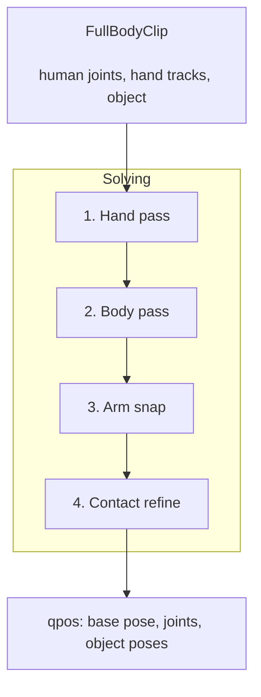

# Full-Body Retargeting

|  |  |
| --- | --- |
| Whole-body tracking with object contacts. | A ParaHome cutting-board clip retargeted whole-body. |


`robokit.helpers.full_body_retargeting` maps a captured human-object interaction onto a
humanoid with dexterous hands. It combines the two solvers in this repo: whole-body tracking
from [humanoid retargeting](humanoid_retargeting.md) and captured fingers from
[hand retargeting](hand_retargeting.md), then welds the arms so the palms land where the hands
went.

Complete runnable programs are in
[`src/robokit/examples/humanoid_retargeting`](../../src/robokit/examples/humanoid_retargeting/).

## How It Works

A clip carries the human body, each hand, and the object it holds. Every stage runs per
engaged hand, so one- and two-handed clips take the same path:

1. **hand pass** - captured MANO keypoints onto the standalone hand, in the capture world.
2. **body pass** - whole-body tracking, with each grasp wrist injected as a high-weight target.
3. **arm snap** - an arm-only IK puts each palm exactly at the hand-pass pose.
4. **contact refine** - fingers re-solve at the achieved wrist against that hand's object mesh.

Stages 2-4 run twice so the body absorbs the wrist correction.



Stage 3 is not redundant with stage 2: the body pass carries the wrist as one soft target
among many, which leaves the palm tens of millimetres off, while the arm snap dedicates the
arm joints to hitting it exactly.

## Loading a Clip

Loaders live beside the package and return a `FullBodyClip`. ParaHome ships with one; its
interactions are mined from the annotations, then loaded by index:

```python
# docs: hide
# xdoctest: +REQUIRES(env:ROBOKIT_PARAHOME_DOCS==1)
device = "cpu"
# docs: endhide
from robokit.assets.datasets import parahome
from robokit.helpers.full_body_retargeting.parahome_utils import find_parahome_intervals, load_parahome_clip

data_root = str(parahome.data_root())
interval = find_parahome_intervals(data_root, "s1")[2]  # "Put pot on gas stove"
clip = load_parahome_clip(data_root, interval, device=device, load_scene=True)
# docs: hide
assert clip.num_frames > 0
# docs: endhide
```

`load_scene=True` also loads the untouched room parts into `clip.scene`. A clip exposes
`num_frames`, `sides` (`"right"` before `"left"`), and `object_names`.

## Retargeting a Clip

`FullBodyRetargeter` loads the G1 + Inspire assembly and both standalone hands. The output
packs one row per frame:

| segment | width | contents |
| --- | --- | --- |
| base | 7 | `(x, y, z, qw, qx, qy, qz)` |
| joints | `dofs` | actuated joint positions, body then fingers |
| objects | `7 * len(clip.object_names)` | one pose per grasped object |

```python
# docs: hide
# xdoctest: +REQUIRES(env:ROBOKIT_ASSET_TESTS==1)
import numpy as np
import trimesh
import warp as wp
from robokit.helpers.full_body_retargeting import FullBodyClip, FullBodyRetargeter
from robokit.helpers.full_body_retargeting.clip import HandTrack

device = "cuda:0" if wp.is_cuda_available() else "cpu"
num_frames = 3
human = np.zeros((num_frames, 55, 7), dtype=np.float32)
human[..., 3] = 1.0
human[..., 2] = np.linspace(0.2, 1.6, 55)
human[..., 0] = 0.05 * np.sin(np.arange(55))
hands = {}
for side, x in (("right", -0.15), ("left", 0.15)):
    points = np.zeros((num_frames, 21, 3), dtype=np.float32)
    points[..., 0], points[..., 2] = x, 1.0
    points[..., 1] = np.linspace(0.0, 0.08, 21)
    T_world_object = np.tile([0, 0, 1, 1, 0, 0, 0], (num_frames, 1)).astype(np.float32)
    hands[side] = HandTrack(
        mano=points,
        q_wxyz_world_wrist=np.tile([1, 0, 0, 0], (num_frames, 1)).astype(np.float32),
        object_name="box",
        object_mesh=trimesh.creation.box((0.08, 0.08, 0.08)),
        T_native_object=T_world_object.copy(),
        T_world_object=T_world_object,
        contact_points=np.zeros((num_frames, 10, 3), dtype=np.float32),
        contact_normals=np.zeros((num_frames, 10, 3), dtype=np.float32),
        contact_mask=np.zeros((num_frames, 10), dtype=bool),
    )
clip = FullBodyClip(T_native_human=human, human_height=1.7, scale=0.78, fps=30, hands=hands)
# docs: endhide
from robokit.helpers.full_body_retargeting import FullBodyRetargeter

retargeter = FullBodyRetargeter(device=device)
qpos = retargeter.solve(clip)  # (frames, 7 + dofs + 7 * num_objects)
# docs: hide
assert qpos.shape[0] == clip.num_frames
assert np.isfinite(qpos).all()
# docs: endhide
```

`max_frames` caps the solve; `0` keeps every frame. Building the retargeter loads four robot models,
so keep one instance and reuse it across clips.

See [`10_full_body.py`](../../src/robokit/examples/humanoid_retargeting/10_full_body.py).

## Holding a Grasp

`solve_grasp_refine` optimizes one stable grasp per sustained contact run and holds it,
instead of tracking the captured fingers frame by frame. It returns the same `qpos` plus the
markers a viewer needs:

```python
# docs: hide
# xdoctest: +REQUIRES(env:ROBOKIT_ASSET_TESTS==1)
import numpy as np
import trimesh
import warp as wp
from robokit.helpers.full_body_retargeting import FullBodyClip, FullBodyRetargeter
from robokit.helpers.full_body_retargeting.clip import HandTrack

device = "cuda:0" if wp.is_cuda_available() else "cpu"
num_frames = 3
human = np.zeros((num_frames, 55, 7), dtype=np.float32)
human[..., 3] = 1.0
human[..., 2] = np.linspace(0.2, 1.6, 55)
human[..., 0] = 0.05 * np.sin(np.arange(55))
hands = {}
for side, x in (("right", -0.15), ("left", 0.15)):
    points = np.zeros((num_frames, 21, 3), dtype=np.float32)
    points[..., 0], points[..., 2] = x, 1.0
    points[..., 1] = np.linspace(0.0, 0.08, 21)
    T_world_object = np.tile([0, 0, 1, 1, 0, 0, 0], (num_frames, 1)).astype(np.float32)
    hands[side] = HandTrack(
        mano=points,
        q_wxyz_world_wrist=np.tile([1, 0, 0, 0], (num_frames, 1)).astype(np.float32),
        object_name="box",
        object_mesh=trimesh.creation.box((0.08, 0.08, 0.08)),
        T_native_object=T_world_object.copy(),
        T_world_object=T_world_object,
        contact_points=np.zeros((num_frames, 10, 3), dtype=np.float32),
        contact_normals=np.zeros((num_frames, 10, 3), dtype=np.float32),
        contact_mask=np.zeros((num_frames, 10), dtype=bool),
    )
clip = FullBodyClip(T_native_human=human, human_height=1.7, scale=0.78, fps=30, hands=hands)
retargeter = FullBodyRetargeter(device=device)
# docs: endhide
from robokit.helpers.full_body_retargeting import solve_grasp_refine

result = solve_grasp_refine(clip, retargeter)
qpos = result.qpos
targets, contacts = result.targets_world, result.contacts_world  # (frames, slots, 3) per side
held = result.contact_masks  # (frames, slots), True while the grasp is fully held
# docs: hide
assert qpos.shape[0] == clip.num_frames
assert np.isfinite(qpos).all()
# docs: endhide
```

A run needs at least three frames of contact and must oppose the thumb against another
finger, so brushes against an object do not become grasps.

## Scene Clearance

Passing `scene_clearance=True` runs one whole-body IK per clip that pushes the core body out
of furniture it penetrates, keeping feet and hands pinned where they landed. Links whose human
counterpart is weight-bearing (sitting, leaning) are left out of the guard so support
survives. It needs `clip.scene`, and its link names assume G1 + Inspire.

```python
# docs: hide
# xdoctest: +REQUIRES(env:ROBOKIT_ASSET_TESTS==1)
import numpy as np
import trimesh
import warp as wp
from robokit.helpers.full_body_retargeting import FullBodyClip, FullBodyRetargeter
from robokit.helpers.full_body_retargeting.clip import HandTrack

device = "cuda:0" if wp.is_cuda_available() else "cpu"
num_frames = 3
human = np.zeros((num_frames, 55, 7), dtype=np.float32)
human[..., 3] = 1.0
human[..., 2] = np.linspace(0.2, 1.6, 55)
human[..., 0] = 0.05 * np.sin(np.arange(55))
hands = {}
for side, x in (("right", -0.15), ("left", 0.15)):
    points = np.zeros((num_frames, 21, 3), dtype=np.float32)
    points[..., 0], points[..., 2] = x, 1.0
    points[..., 1] = np.linspace(0.0, 0.08, 21)
    T_world_object = np.tile([0, 0, 1, 1, 0, 0, 0], (num_frames, 1)).astype(np.float32)
    hands[side] = HandTrack(
        mano=points,
        q_wxyz_world_wrist=np.tile([1, 0, 0, 0], (num_frames, 1)).astype(np.float32),
        object_name="box",
        object_mesh=trimesh.creation.box((0.08, 0.08, 0.08)),
        T_native_object=T_world_object.copy(),
        T_world_object=T_world_object,
        contact_points=np.zeros((num_frames, 10, 3), dtype=np.float32),
        contact_normals=np.zeros((num_frames, 10, 3), dtype=np.float32),
        contact_mask=np.zeros((num_frames, 10), dtype=bool),
    )
clip = FullBodyClip(T_native_human=human, human_height=1.7, scale=0.78, fps=30, hands=hands)
from robokit.helpers.full_body_retargeting import solve_grasp_refine

retargeter = FullBodyRetargeter(device=device)
from robokit.helpers.full_body_retargeting.clip import SceneGeometry

clip.scene = SceneGeometry(
    names=["wall"],
    meshes=[trimesh.creation.box((0.1, 0.1, 1.0))],
    T_world_part=np.tile([2, 0, 0, 1, 0, 0, 0], (1, num_frames, 1)).astype(np.float32),
    static=np.array([True]),
)
# docs: endhide
qpos = retargeter.solve(clip, scene_clearance=True)
result = solve_grasp_refine(clip, retargeter, scene_clearance=True)
# docs: hide
assert np.isfinite(qpos).all()
assert np.isfinite(result.qpos).all()
# docs: endhide
```

## Tuning

`FullBodyRetargetingConfig` is a robot-free recipe whose defaults reproduce the shipped
behavior. Derive a variant with `dataclasses.replace(...)` rather than mutating one:

```python
# docs: hide
# xdoctest: +REQUIRES(env:ROBOKIT_ASSET_TESTS==1)
import warp as wp
from robokit.helpers.full_body_retargeting import FullBodyRetargeter

device = "cuda:0" if wp.is_cuda_available() else "cpu"
# docs: endhide
import dataclasses

from robokit.helpers.full_body_retargeting import FullBodyRetargetingConfig

config = dataclasses.replace(FullBodyRetargetingConfig(), smooth_window=5)
retargeter = FullBodyRetargeter(config, device=device)
# docs: hide
assert retargeter.config.smooth_window == 5
# docs: endhide
```

Each stage solves its own config's terms: `hand_pass` (and `grasp_hand_pass` for grasp
refinement), the whole-`body` pass with its per-link wrist and elbow weights, the
`arm_snap` IK, and `contact_refine`. The remaining fields configure span clamps,
iterations and smoothing windows.

See [`robokit.gallery.full_body_retargeting`](../../src/robokit/gallery/full_body_retargeting.py), which browses every
ParaHome sequence and interval with grasp refinement and scene clearance as toggles.
