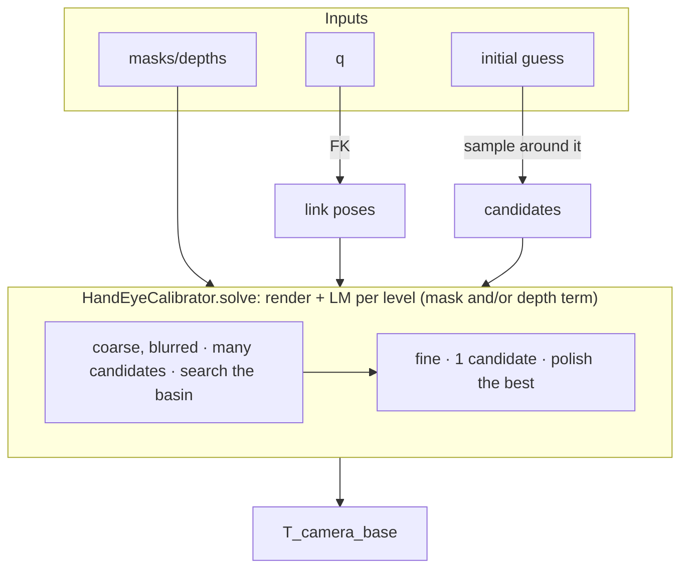

# Hand-Eye Calibration


`robokit.helpers.hand_eye_calibration` solves the camera extrinsic (OpenCV `T_camera_base`) from robot
silhouette masks and/or depth maps. Given N images with known joint positions `q`, it
renders the robot with nvdiffrast and aligns the rendered masks to the targets with a
coarse-to-fine multi-candidate Levenberg-Marquardt solver, no calibration board needed.

## Overview



## Quick start

From [src/robokit/examples/hand_eye_calibration/01_sim_rgb.py](../../src/robokit/examples/hand_eye_calibration/01_sim_rgb.py) (fixed camera, masks only):

```python
# docs: hide
# xdoctest: +REQUIRES(env:ROBOKIT_CUDA_DOCS==1,module:nvdiffrast)
import torch
from robokit.helpers.hand_eye_calibration import compute_robot_masks
from robokit.robo import Robot

# A one-joint box robot needs no external assets.
robot = Robot.load(
    """<robot name="demo">
  <link name="base"><visual><geometry><box size=".3 .2 .1"/></geometry></visual></link>
  <link name="arm"><visual><origin xyz=".2 0 0"/><geometry><box size=".4 .1 .1"/></geometry></visual></link>
  <joint name="joint" type="revolute">
    <parent link="base"/><child link="arm"/><axis xyz="0 0 1"/>
    <limit lower="-3.14" upper="3.14" effort="1" velocity="1"/>
  </joint>
</robot>""",
    load_meshes=True,
)
H = W = 64
q = torch.tensor([[-0.6], [-0.2], [0.2], [0.6]], device="cuda")
intrinsic = torch.tensor([[80.0, 0, W / 2], [0, 80.0, H / 2], [0, 0, 1]], device="cuda")
initial = torch.eye(4, device="cuda")
initial[2, 3] = 1.5
masks = compute_robot_masks(robot, q, intrinsic, initial, H, W)
# docs: endhide
from robokit.helpers.hand_eye_calibration import HandEyeCalibrator, presets

hec = HandEyeCalibrator(presets.rgb, robot, camera_intrinsic=intrinsic, height=H, width=W)
predicted = hec.solve(initial, target_masks=masks, q=q)
# docs: hide
assert predicted.shape == (4, 4)
assert torch.isfinite(predicted).all()
# docs: endhide
```

`masks` are `[N, H, W]` float robot silhouettes, `q` is `[N, num_dofs]` in
`robot.spec.actuated_joint_names` order, `initial` is a rough `[4, 4]` guess
(up to ~35 cm / 45 deg off is fine with the default config).

## Common variants

**Mounted camera.** For a camera on a moving mount (e.g. wrist cam), pass per-sample
`T_mount_base`; the solve then happens in the mount frame and returns
`T_camera_mount`. See
[src/robokit/examples/hand_eye_calibration/02_sim_mounted.py](../../src/robokit/examples/hand_eye_calibration/02_sim_mounted.py):

```python
# docs: hide
# xdoctest: +REQUIRES(env:ROBOKIT_CUDA_DOCS==1,module:nvdiffrast)
import torch
from robokit.helpers.hand_eye_calibration import HandEyeCalibrator, compute_robot_masks, presets
from robokit.robo import Robot

# A one-joint box robot needs no external assets.
robot = Robot.load(
    """<robot name="demo">
  <link name="base"><visual><geometry><box size=".3 .2 .1"/></geometry></visual></link>
  <link name="arm"><visual><origin xyz=".2 0 0"/><geometry><box size=".4 .1 .1"/></geometry></visual></link>
  <joint name="joint" type="revolute">
    <parent link="base"/><child link="arm"/><axis xyz="0 0 1"/>
    <limit lower="-3.14" upper="3.14" effort="1" velocity="1"/>
  </joint>
</robot>""",
    load_meshes=True,
)
H = W = 64
q = torch.tensor([[-0.6], [-0.2], [0.2], [0.6]], device="cuda")
intrinsic = torch.tensor([[80.0, 0, W / 2], [0, 80.0, H / 2], [0, 0, 1]], device="cuda")
initial = torch.eye(4, device="cuda")
initial[2, 3] = 1.5
masks = compute_robot_masks(robot, q, intrinsic, initial, H, W)
T_mount_base = torch.eye(4, device="cuda").repeat(len(q), 1, 1)
hec = HandEyeCalibrator(presets.rgb, robot, camera_intrinsic=intrinsic, height=H, width=W)
# docs: endhide
predicted = hec.solve(initial, target_masks=masks, q=q, T_mount_base=T_mount_base)
# docs: hide
assert predicted.shape == (4, 4)
assert torch.isfinite(predicted).all()
# docs: endhide
```

**Depth.** Each `PyramidLevel` has a `use_depth` flag. Enable it on the fine levels
for an RGB-D polish, or on every level for depth-only (masks omitted; pass robot-only
depth with 0 = invalid). See
[src/robokit/examples/hand_eye_calibration/03_sim_depth.py](../../src/robokit/examples/hand_eye_calibration/03_sim_depth.py):

```python
# docs: hide
# xdoctest: +REQUIRES(env:ROBOKIT_CUDA_DOCS==1,module:nvdiffrast)
import torch
import nvdiffrast.torch as dr
from robokit.helpers.hand_eye_calibration.calibrator import build_robot_render_data
from robokit.helpers.hand_eye_calibration.mask_alignment_task import _precompute_merged_mesh, _render_batch
from robokit.robo import Robot

# A one-joint box robot needs no external assets.
robot = Robot.load(
    """<robot name="demo">
  <link name="base"><visual><geometry><box size=".3 .2 .1"/></geometry></visual></link>
  <link name="arm"><visual><origin xyz=".2 0 0"/><geometry><box size=".4 .1 .1"/></geometry></visual></link>
  <joint name="joint" type="revolute">
    <parent link="base"/><child link="arm"/><axis xyz="0 0 1"/>
    <limit lower="-3.14" upper="3.14" effort="1" velocity="1"/>
  </joint>
</robot>""",
    load_meshes=True,
)
H = W = 64
q = torch.tensor([[-0.6], [-0.2], [0.2], [0.6]], device="cuda")
intrinsic = torch.tensor([[80.0, 0, W / 2], [0, 80.0, H / 2], [0, 0, 1]], device="cuda")
initial = torch.eye(4, device="cuda")
initial[2, 3] = 1.5
transforms, vertices, faces = build_robot_render_data(robot, q)
faces, vertices = _precompute_merged_mesh(vertices, faces, transforms)
with torch.no_grad():
    masks, positions = _render_batch(dr.RasterizeCudaContext(), initial, intrinsic, faces, vertices, H, W)
depths = positions[..., 2].clamp(min=0) * (masks > 0.5)
# docs: endhide
from robokit.helpers.hand_eye_calibration import HandEyeCalibrator, presets

hec = HandEyeCalibrator(presets.depth, robot, camera_intrinsic=intrinsic, height=H, width=W)
predicted = hec.solve(initial, target_depths=depths, q=q)
# docs: hide
assert predicted.shape == (4, 4)
assert torch.isfinite(predicted).all()
# docs: endhide
```

`presets.rgb_single_level` runs the full-resolution RGB level with the coarse-to-fine preset's
total iteration budget; the benchmark uses it for the single-level comparison.

`presets.rgb` / `presets.rgbd` / `presets.depth` are prebuilt configs; for a custom
schedule set `use_depth` per `PyramidLevel`, and `depth_weight` on the mask-alignment task in `config.terms`.

**Model offsets.** The extrinsic is not the only unknown: encoder zero offsets and an
unknown arm/hand adapter both shift the rendered robot, and a camera-only solve can only
absorb them by biasing the extrinsic. Swap the pyramid's mask task for
`MaskAlignmentOffsetTask` and those become variables too - `offset_joints` frees the zero
of existing joints, `offset_link` frees the transform a link hangs from (a virtual six-dof
joint). See [05_sim_offsets.py](../../src/robokit/examples/hand_eye_calibration/05_sim_offsets.py),
using `--offset joints` or `--offset mount`:

```python
# docs: hide
# xdoctest: +REQUIRES(env:ROBOKIT_CUDA_DOCS==1,module:nvdiffrast)
import torch
from robokit.helpers.hand_eye_calibration import HandEyeCalibrator, compute_robot_masks, presets
from robokit.robo import Robot

# A one-joint box robot needs no external assets.
robot = Robot.load(
    """<robot name="demo">
  <link name="base"><visual><geometry><box size=".3 .2 .1"/></geometry></visual></link>
  <link name="arm"><visual><origin xyz=".2 0 0"/><geometry><box size=".4 .1 .1"/></geometry></visual></link>
  <joint name="joint" type="revolute">
    <parent link="base"/><child link="arm"/><axis xyz="0 0 1"/>
    <limit lower="-3.14" upper="3.14" effort="1" velocity="1"/>
  </joint>
</robot>""",
    load_meshes=True,
)
H = W = 64
q = torch.tensor([[-0.6], [-0.2], [0.2], [0.6]], device="cuda")
intrinsic = torch.tensor([[80.0, 0, W / 2], [0, 80.0, H / 2], [0, 0, 1]], device="cuda")
initial = torch.eye(4, device="cuda")
initial[2, 3] = 1.5
masks = compute_robot_masks(robot, q, intrinsic, initial, H, W)
# docs: endhide
from dataclasses import replace
import warp as wp
from robokit.opt.var_values import VarKey
from robokit.helpers.hand_eye_calibration.mask_alignment_task import MaskAlignmentOffsetTask
from robokit.terms.dense.configuration_task import ConfigurationTask

rest = ConfigurationTask(rest_q=robot.spec.zero_q, weight=150.0, var_key=VarKey.QPOS_OFFSET)
mask_term = MaskAlignmentOffsetTask(offset_joints=list(range(robot.num_actuated_joints)))
hec = HandEyeCalibrator(replace(presets.rgb, terms=[mask_term, rest]), robot, intrinsic, H, W)
predicted = hec.solve(initial, target_masks=masks, q=q)
delta_q = wp.to_torch(hec.last_var.get(VarKey.QPOS_OFFSET).x)[0]  # radians, add to measured q
# docs: hide
assert delta_q.shape == (robot.num_actuated_joints,)
assert torch.isfinite(predicted).all() and torch.isfinite(delta_q).all()
# docs: endhide
```

`config.terms` holds every cost term, mask alignment included; each one is handed the
solve's data and walks the pyramid itself.

`offset_link_dofs` keeps only part of the mount twist (translation- or rotation-only).
Weakly observable dofs - a roll about a round wrist flange - drift unless the `ConfigurationTask`
holds them near nominal.

**Real hardware.** [src/robokit/examples/hand_eye_calibration/04_real_xarm.py](../../src/robokit/examples/hand_eye_calibration/04_real_xarm.py)
runs the full pipeline on an xArm + RealSense: capture images at a set of joint
configurations, segment the arm with SAM2, drag an initial guess in viser, then solve.
Larger initial errors need more candidates; it bumps `candidate_noise_t/r` and the solver's
`num_candidates` and iterations over the defaults.

**Unknown frame qpos.** Fit q from silhouette views of one frame.

| Preset | Optimized variables |
|---|---|
| `presets.rgb` | Camera; q is supplied |
| `presets.rgb_qpos` | Qpos; camera is fixed |
| `presets.rgb_qpos_camera` | Qpos and camera |

Pass `target_masks[V,H,W]` and optional initial `q[J]`; read `last_q[J]`.
Omit `q` to search the full joint limits.

[Frame and trajectory comparison](../../src/robokit/examples/hand_eye_calibration/06_sim_qpos.py).

**Joint trajectories (experimental).** `QposTrajectoryCalibrator` fits
`last_q[T,J]` from `masks[T,V,H,W]` and
`timestamps[T]`, with velocity and acceleration smoothing.
Use `presets.rgb_qpos_trajectory` for fixed cameras, or
`presets.rgb_qpos_trajectory_camera` to also refine static cameras.

Both APIs accept image keypoints through `keypoint_links` and
`target_keypoints`; NaNs mark missing points.

[Trajectory example](../../src/robokit/examples/hand_eye_calibration/06_sim_qpos.py)
· [Benchmark](../../scripts/benchmark/hand_eye_calibration/README.md).
