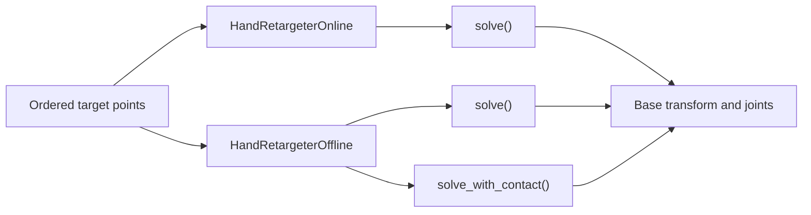

# Hand Retargeting

|  |  |
| --- | --- |
| An XHand on an xArm7 replaying a captured hand motion. | Hand-object retargeting across three datasets. |

`robokit.helpers.hand_retargeting` maps ordered hand points to robot states. Online retargeting
solves one frame at a time. Offline retargeting solves a whole trajectory. Complete programs are in
[`src/robokit/examples/hand_retargeting`](../../src/robokit/examples/hand_retargeting/).

## How Retargeting Works



## Presets

Each robot preset is a module with one hand spec and a config per workflow.

```python
from robokit.helpers.hand_retargeting.presets import shadow

spec = shadow.spec
online_config = shadow.online
online_wrist_config = shadow.online_wrist
offline_config = shadow.offline
# docs: hide
assert online_wrist_config.reference_origin == "wrist"
# docs: endhide
```

Order points as `spec.target_names`. The MANO layout is not assumed.

| Workflow | NumPy input | Output |
| --- | --- | --- |
| Online | `(K, 3)` or `(B, K, 3)` | `(B, 7 + Q)` |
| Offline | `(T, K, 3)` or `(B, T, K, 3)` | `(T, 7 + Q)` or `(B, T, 7 + Q)` |

`B` is batch size, `T` frame count, `K` is `len(spec.target_names)`, and `Q` actuated joints.
Each output row is the base transform `(x, y, z, qw, qx, qy, qz)` followed by the joints.

## Online Retargeting

A preset's costs are tasks in `config.terms`; change one by name:

```python
# docs: hide
from robokit.helpers.hand_retargeting.presets import shadow

# docs: endhide
from copy import deepcopy

config = deepcopy(shadow.online)
config.task("smoothness").weight = 0.1
config.task("rest").weight = 0.01
```

Offline configs work the same way. `contact_config()` and `refine_config()` derive the contact and
refinement problems from a tracking config.

Online retargeting follows `__init__ → warmup → solve → reset`, one frame per `solve`; the caller owns
the loop. Each frame after the first is smoothed against the previous solution.

```python
# docs: hide
# xdoctest: +SKIP
import numpy as np
import warp as wp
from robokit.assets.robots.end_effectors import shadow_hand
from robokit.helpers.hand_retargeting import HandRetargeterOffline
from robokit.helpers.hand_retargeting.presets import shadow
from robokit.robo import Robot

device = "cuda:0" if wp.is_cuda_available() else "cpu"
robot = Robot.load(
    shadow_hand.URDF_PATH_RIGHT,
    load_collision_spheres=True,
    collision_spheres_path=shadow_hand.COLLISION_SPHERE_PATH_RIGHT,
)
# A three-frame synthetic hand, ordered as shadow.spec.target_names.
points = np.zeros((3, 21, 3), dtype=np.float32)
for finger in range(5):
    for joint in range(4):
        points[:, 1 + 4 * finger + joint] = [(finger - 2) * 0.025, (joint + 1) * 0.025, 0.0]
stream = [frame[None] for frame in points]
root_quat_wxyz = np.tile([1, 0, 0, 0], (3, 1)).astype(np.float32)
# docs: endhide
from robokit.helpers.hand_retargeting import HandRetargeterOnline

retargeter = HandRetargeterOnline(
    config=shadow.online,
    robot=robot,
    spec=shadow.spec,
    device=device,
)
retargeter.warmup(batch_size=1)

for points in stream:
    qpos = retargeter.solve_numpy(target_points=points)

retargeter.reset()
# docs: hide
assert qpos.shape[-1] == robot.spec.num_actuated_joints + 7
assert np.isfinite(qpos).all()
# docs: endhide
```

See [`01_online.py`](../../src/robokit/examples/hand_retargeting/01_online.py),
[`05_online_batch.py`](../../src/robokit/examples/hand_retargeting/05_online_batch.py), and
[`03_batch.py`](../../src/robokit/examples/hand_retargeting/03_batch.py).

### Wrist Tracking

Pass an `online_wrist` preset to `HandRetargeterOnline` to track the wrist pose and finger joints
together. Floating hands take world points and return the base transform in the world frame:

```python
# docs: hide
# xdoctest: +SKIP
import numpy as np
import warp as wp
from robokit.assets.robots.end_effectors import shadow_hand
from robokit.helpers.hand_retargeting import HandRetargeterOffline
from robokit.helpers.hand_retargeting.presets import shadow
from robokit.robo import Robot

device = "cuda:0" if wp.is_cuda_available() else "cpu"
robot = Robot.load(
    shadow_hand.URDF_PATH_RIGHT,
    load_collision_spheres=True,
    collision_spheres_path=shadow_hand.COLLISION_SPHERE_PATH_RIGHT,
)
# A three-frame synthetic hand, ordered as shadow.spec.target_names.
points = np.zeros((3, 21, 3), dtype=np.float32)
for finger in range(5):
    for joint in range(4):
        points[:, 1 + 4 * finger + joint] = [(finger - 2) * 0.025, (joint + 1) * 0.025, 0.0]
stream = [frame[None] for frame in points]
root_quat_wxyz = np.tile([1, 0, 0, 0], (3, 1)).astype(np.float32)
# docs: endhide
from robokit.helpers.hand_retargeting import HandRetargeterOnline

retargeter = HandRetargeterOnline(shadow.online_wrist, robot, shadow.spec, device=device)
retargeter.warmup(batch_size=1)
for points in stream:
    qpos = retargeter.solve_numpy(points)
retargeter.reset()
# docs: hide
assert qpos.shape[-1] == robot.spec.num_actuated_joints + 7
assert np.isfinite(qpos).all()
# docs: endhide
```

Wrist presets set `reference_origin="wrist"`; the default is `"world"`. Inputs and outputs stay
in world coordinates either way, including `init_state` and `compute_costs(state)`. Fixed-base arm
rigs take points and states in the robot base frame.

## Offline Retargeting

`solve_numpy()` warms up for its input shape. The Warp API needs
`warmup(batch_size=B, num_frames=T)` before `solve()`.

```python
# docs: hide
# xdoctest: +SKIP
import numpy as np
import warp as wp
from robokit.assets.robots.end_effectors import shadow_hand
from robokit.helpers.hand_retargeting import HandRetargeterOffline
from robokit.helpers.hand_retargeting.presets import shadow
from robokit.robo import Robot

device = "cuda:0" if wp.is_cuda_available() else "cpu"
robot = Robot.load(
    shadow_hand.URDF_PATH_RIGHT,
    load_collision_spheres=True,
    collision_spheres_path=shadow_hand.COLLISION_SPHERE_PATH_RIGHT,
)
# A three-frame synthetic hand, ordered as shadow.spec.target_names.
points = np.zeros((3, 21, 3), dtype=np.float32)
for finger in range(5):
    for joint in range(4):
        points[:, 1 + 4 * finger + joint] = [(finger - 2) * 0.025, (joint + 1) * 0.025, 0.0]
stream = [frame[None] for frame in points]
root_quat_wxyz = np.tile([1, 0, 0, 0], (3, 1)).astype(np.float32)
# docs: endhide
from robokit.helpers.hand_retargeting import HandRetargeterOffline

retargeter = HandRetargeterOffline(
    config=shadow.offline,
    robot=robot,
    spec=shadow.spec,
    device=device,
)
qpos = retargeter.solve_numpy(
    target_points=points,
    root_quat_wxyz=root_quat_wxyz,
)
# docs: hide
assert qpos.shape == (3, robot.spec.num_actuated_joints + 7)
assert np.isfinite(qpos).all()
# docs: endhide
```

Pass `root_quat_wxyz` when a task reads the root pose; the default `root_rotation` task does.
Split long trajectories into chunks yourself.

See [`02_offline.py`](../../src/robokit/examples/hand_retargeting/02_offline.py) and
[`04_arm.py`](../../src/robokit/examples/hand_retargeting/04_arm.py).

## Contact and Collision

Contact solves take one contact point and mask per `spec.contact_target_names` entry. Wrap a
tracking config with `contact_config()`. Use `refine_config()` to keep the result near `init_state`.

```python
# docs: hide
# xdoctest: +SKIP
import numpy as np
import warp as wp
from robokit.assets.robots.end_effectors import shadow_hand
from robokit.helpers.hand_retargeting import HandRetargeterOffline
from robokit.helpers.hand_retargeting.presets import shadow
from robokit.robo import Robot

device = "cuda:0" if wp.is_cuda_available() else "cpu"
robot = Robot.load(
    shadow_hand.URDF_PATH_RIGHT,
    load_collision_spheres=True,
    collision_spheres_path=shadow_hand.COLLISION_SPHERE_PATH_RIGHT,
)
# A three-frame synthetic hand, ordered as shadow.spec.target_names.
points = np.zeros((3, 21, 3), dtype=np.float32)
for finger in range(5):
    for joint in range(4):
        points[:, 1 + 4 * finger + joint] = [(finger - 2) * 0.025, (joint + 1) * 0.025, 0.0]
stream = [frame[None] for frame in points]
root_quat_wxyz = np.tile([1, 0, 0, 0], (3, 1)).astype(np.float32)
from robokit.geom import PlaneGeom, WarpScene

scene = WarpScene(1, device).add(PlaneGeom(np.array([0, 1], dtype=np.int32)))
contact_points = points[:, [4, 8, 12, 16, 20]].copy()
contact_mask = np.zeros((3, 5), dtype=bool)
local_contact_points = np.zeros((3, 5, 3), dtype=np.float32)
init_state = None
# docs: endhide
from robokit.helpers.hand_retargeting import contact_config

retargeter = HandRetargeterOffline(
    config=contact_config(shadow.offline),
    robot=robot,
    spec=shadow.spec,
    scene=scene,
    device=device,
)
qpos = retargeter.solve_with_contact_numpy(
    target_points=points,
    contact_points=contact_points,
    contact_mask=contact_mask,
    init_state=init_state,
    local_contact_points=local_contact_points,
)
# docs: hide
assert qpos.shape == (3, robot.spec.num_actuated_joints + 7)
assert np.isfinite(qpos).all()
# docs: endhide
```

Pass `init_state` to start from a trajectory; the refinement keeps the result near it.

Pass a `WarpScene` for scene collision; `config.task("collision").weight` sets its cost. Self-collision
uses the robot's collision spheres and the skip pairs from `Robot.load(self_collision_ignore_path=...)`.

See [`06_contact.py`](../../src/robokit/examples/hand_retargeting/06_contact.py).
[`07_batch_contact.py`](../../src/robokit/examples/hand_retargeting/07_batch_contact.py) retargets
every right-hand DexYCB capture and writes one NPZ per capture:
`uv run src/robokit/examples/hand_retargeting/07_batch_contact.py --output-dir PATH`.
