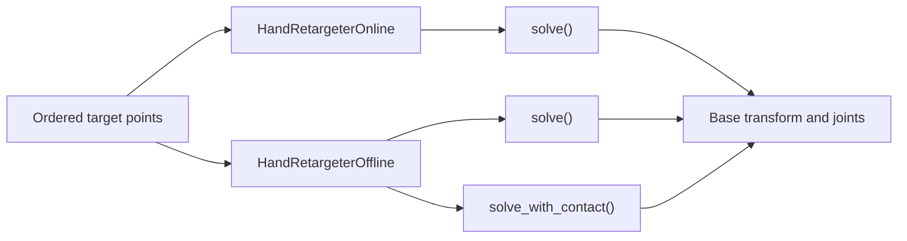

# Hand Retargeting

| An XHand on an xArm7 replaying a captured hand motion. | Hand-object retargeting across three datasets. |
| --- | --- |

`robokit.helpers.hand_retargeting` maps ordered hand points to robot states. Online retargeting solves one frame at a time; offline retargeting jointly solves a trajectory. Complete programs are in [`src/robokit/examples/hand_retargeting`](../../src/robokit/examples/hand_retargeting/).

## How Retargeting Works



## Presets

Each robot preset is a module with a shared hand specification and separate workflow configurations.

```python
from robokit.helpers.hand_retargeting.presets import shadow

spec = shadow.spec
online_config = shadow.online
online_wrist_config = shadow.online_wrist
offline_config = shadow.offline
# docs: hide
assert online_wrist_config.reference_origin == "wrist"
# docs: endhide
```

The point axis follows `spec.target_names`; it does not assume a MANO layout.

| Workflow | NumPy input | Output |
| --- | --- | --- |
| Online | `(K, 3)` or `(B, K, 3)` | `(B, 7 + Q)` |
| Offline | `(T, K, 3)` or `(B, T, K, 3)` | `(T, 7 + Q)` or `(B, T, 7 + Q)` |

Here `B` is batch size, `T` is frame count, `K` is `len(spec.target_names)`, and `Q` is the number of actuated robot joints. Each output packs the base transform `(x, y, z, qw, qx, qy, qz)` before the joints.

## Online Retargeting

Objective parameters belong to tasks in `config.terms`. A template names the
helper inputs it reads with `HandContext` members, and the retargeter builds every
template the same way. The correspondence templates read `POINTS`, or `VECTORS` and
`DIRECTIONS`, which hold every ordered target pair; their weights, keyed by target or
by `(origin link, task link, origin target, task target)`, pick the rows. Smoothness
reads `PREVIOUS_STATE` and ramps in with `FRAME`; the rest pose reads `REST_Q`. Names
such as `positions` or `smoothness` only label the presets' templates for
`config.task(name)`. For example:

```python
# docs: hide
from robokit.helpers.hand_retargeting.presets import shadow

# docs: endhide
from copy import deepcopy

config = deepcopy(shadow.online)
config.task("smoothness").weight = 0.1
config.task("self_collision").weight = 10.0
config.task("self_collision").margin = 0.005
```

The offline retargeter builds every template in `config.terms` the same way, from
`HandContext` inputs such as `CONTACT_LINKS`, `ROOT_POSE` or `REFERENCE_Q`. One config
is one problem: `contact_config()` and `refine_config()` derive the contact and
refinement problems from a tracking config. Wrist presets carry their own task list;
coordinate centering and sampling remain configuration settings. Use
`config.task(name).dense_task` to configure a trajectory wrapper's per-pose task.

Online retargeting follows `__init__ → warmup → solve → reset`. The caller owns the frame loop.
Each solve processes one frame. The first frame after warmup/reset has no temporal
cost; later frames are smoothed against the preceding solution. An explicit
`init_state` changes the optimization seed without replacing that history.

```python
# docs: hide
# xdoctest: +REQUIRES(env:ROBOKIT_ASSET_TESTS==1)
import numpy as np
import warp as wp
from robokit.assets.robots.end_effectors import shadow_hand
from robokit.helpers.hand_retargeting import HandRetargeterOffline
from robokit.helpers.hand_retargeting.presets import shadow
from robokit.robo import Robot

device = "cuda:0" if wp.is_cuda_available() else "cpu"
robot = Robot.load(
    shadow_hand.URDF_PATH_RIGHT,
    load_collision_spheres=True,
    collision_spheres_path=shadow_hand.COLLISION_SPHERE_PATH_RIGHT,
)
# A three-frame synthetic hand, ordered as shadow.spec.target_names.
points = np.zeros((3, 21, 3), dtype=np.float32)
for finger in range(5):
    for joint in range(4):
        points[:, 1 + 4 * finger + joint] = [(finger - 2) * 0.025, (joint + 1) * 0.025, 0.0]
stream = [frame[None] for frame in points]
root_quat_wxyz = np.tile([1, 0, 0, 0], (3, 1)).astype(np.float32)
# docs: endhide
from robokit.helpers.hand_retargeting import HandRetargeterOnline

retargeter = HandRetargeterOnline(
    config=shadow.online,
    robot=robot,
    spec=shadow.spec,
    device=device,
)
retargeter.warmup(batch_size=1)

for points in stream:
    qpos = retargeter.solve_numpy(target_points=points)

retargeter.reset()
# docs: hide
assert qpos.shape[-1] == robot.spec.num_actuated_joints + 7
assert np.isfinite(qpos).all()
# docs: endhide
```

See [`01_online.py`](../../src/robokit/examples/hand_retargeting/01_online.py), [`05_online_batch.py`](../../src/robokit/examples/hand_retargeting/05_online_batch.py), and [`03_batch.py`](../../src/robokit/examples/hand_retargeting/03_batch.py).

### Wrist Tracking

Pass an `online_wrist` preset to `HandRetargeterOnline` to jointly track wrist pose and
finger joints. Floating hands accept world keypoints and return the base transform in
that same world frame:

```python
# docs: hide
# xdoctest: +REQUIRES(env:ROBOKIT_ASSET_TESTS==1)
import numpy as np
import warp as wp
from robokit.assets.robots.end_effectors import shadow_hand
from robokit.helpers.hand_retargeting import HandRetargeterOffline
from robokit.helpers.hand_retargeting.presets import shadow
from robokit.robo import Robot

device = "cuda:0" if wp.is_cuda_available() else "cpu"
robot = Robot.load(
    shadow_hand.URDF_PATH_RIGHT,
    load_collision_spheres=True,
    collision_spheres_path=shadow_hand.COLLISION_SPHERE_PATH_RIGHT,
)
# A three-frame synthetic hand, ordered as shadow.spec.target_names.
points = np.zeros((3, 21, 3), dtype=np.float32)
for finger in range(5):
    for joint in range(4):
        points[:, 1 + 4 * finger + joint] = [(finger - 2) * 0.025, (joint + 1) * 0.025, 0.0]
stream = [frame[None] for frame in points]
root_quat_wxyz = np.tile([1, 0, 0, 0], (3, 1)).astype(np.float32)
# docs: endhide
from robokit.helpers.hand_retargeting import HandRetargeterOnline

retargeter = HandRetargeterOnline(shadow.online_wrist, robot, shadow.spec, device=device)
retargeter.warmup(batch_size=1)
for points in stream:
    qpos = retargeter.solve_numpy(points)
retargeter.reset()
# docs: hide
assert qpos.shape[-1] == robot.spec.num_actuated_joints + 7
assert np.isfinite(qpos).all()
# docs: endhide
```

`reference_origin="world"` is the default. The wrist presets use `"wrist"`: the solver
subtracts wrist translation internally and restores it in the output, keeping streaming
history relative to the moving wrist. The coordinate axes are not rotated.
`init_state` and `compute_costs(state)` also use world coordinates. Fixed-base arm rigs
use points and states in the robot base frame; they do not subtract wrist translation.

Wrist presets use `HandRetargeterOnlineConfig`. Tune tracking with `position_weights` and
`direction_weights`; `base_smoothness_weight` controls wrist smoothing for floating hands.

## Offline Retargeting

`solve_numpy()` warms the solver for the input batch and trajectory shape. The Warp API uses `warmup(batch_size=B, num_frames=T)` before `solve()`.

```python
# docs: hide
# xdoctest: +REQUIRES(env:ROBOKIT_ASSET_TESTS==1)
import numpy as np
import warp as wp
from robokit.assets.robots.end_effectors import shadow_hand
from robokit.helpers.hand_retargeting import HandRetargeterOffline
from robokit.helpers.hand_retargeting.presets import shadow
from robokit.robo import Robot

device = "cuda:0" if wp.is_cuda_available() else "cpu"
robot = Robot.load(
    shadow_hand.URDF_PATH_RIGHT,
    load_collision_spheres=True,
    collision_spheres_path=shadow_hand.COLLISION_SPHERE_PATH_RIGHT,
)
# A three-frame synthetic hand, ordered as shadow.spec.target_names.
points = np.zeros((3, 21, 3), dtype=np.float32)
for finger in range(5):
    for joint in range(4):
        points[:, 1 + 4 * finger + joint] = [(finger - 2) * 0.025, (joint + 1) * 0.025, 0.0]
stream = [frame[None] for frame in points]
root_quat_wxyz = np.tile([1, 0, 0, 0], (3, 1)).astype(np.float32)
# docs: endhide
from robokit.helpers.hand_retargeting import HandRetargeterOffline

retargeter = HandRetargeterOffline(
    config=shadow.offline,
    robot=robot,
    spec=shadow.spec,
    device=device,
)
qpos = retargeter.solve_numpy(
    target_points=points,
    root_quat_wxyz=root_quat_wxyz,
)
# docs: hide
assert qpos.shape == (3, robot.spec.num_actuated_joints + 7)
assert np.isfinite(qpos).all()
# docs: endhide
```

`root_quat_wxyz` is optional unless an active task reads the root pose, as the default `root_rotation` does. The caller splits long trajectories into chunks when needed.

Each retargeter solves its config's `terms`, whose `HandContext` placeholders name the inputs the helper fills: target points, contact links, the root pose, and so on. Any task built from those placeholders joins the solve.

See [`02_offline.py`](../../src/robokit/examples/hand_retargeting/02_offline.py) and [`04_arm.py`](../../src/robokit/examples/hand_retargeting/04_arm.py).

## Contact and Collision

Contact solves add one contact point and mask per `spec.contact_target_names` entry. `contact_config()` derives the contact-tracking problem from a tracking config, and `refine_config()` derives an anchored refinement that keeps the result near `init_state`.

```python
# docs: hide
# xdoctest: +REQUIRES(env:ROBOKIT_ASSET_TESTS==1)
import numpy as np
import warp as wp
from robokit.assets.robots.end_effectors import shadow_hand
from robokit.helpers.hand_retargeting import HandRetargeterOffline
from robokit.helpers.hand_retargeting.presets import shadow
from robokit.robo import Robot

device = "cuda:0" if wp.is_cuda_available() else "cpu"
robot = Robot.load(
    shadow_hand.URDF_PATH_RIGHT,
    load_collision_spheres=True,
    collision_spheres_path=shadow_hand.COLLISION_SPHERE_PATH_RIGHT,
)
# A three-frame synthetic hand, ordered as shadow.spec.target_names.
points = np.zeros((3, 21, 3), dtype=np.float32)
for finger in range(5):
    for joint in range(4):
        points[:, 1 + 4 * finger + joint] = [(finger - 2) * 0.025, (joint + 1) * 0.025, 0.0]
stream = [frame[None] for frame in points]
root_quat_wxyz = np.tile([1, 0, 0, 0], (3, 1)).astype(np.float32)
from robokit.geom import PlaneGeom, WarpScene

scene = WarpScene(1, device).add(PlaneGeom(np.array([0, 1], dtype=np.int32)))
contact_points = points[:, [4, 8, 12, 16, 20]].copy()
contact_mask = np.zeros((3, 5), dtype=bool)
local_contact_points = np.zeros((3, 5, 3), dtype=np.float32)
init_state = None
# docs: endhide
from robokit.helpers.hand_retargeting import contact_config

retargeter = HandRetargeterOffline(
    config=contact_config(shadow.offline),
    robot=robot,
    spec=shadow.spec,
    scene=scene,
    device=device,
)
qpos = retargeter.solve_with_contact_numpy(
    target_points=points,
    contact_points=contact_points,
    contact_mask=contact_mask,
    init_state=init_state,
    local_contact_points=local_contact_points,
)
# docs: hide
assert qpos.shape == (3, robot.spec.num_actuated_joints + 7)
assert np.isfinite(qpos).all()
# docs: endhide
```

Supplying `init_state` starts from that trajectory; the refinement config's `anchor` tasks keep the result near it, and its smoothness follows that trajectory's motion.

The caller owns the optional `WarpScene`. Offline scene collision is active when a scene is supplied and `config.task("collision").weight` is nonzero. Online self-collision instead uses the robot collision spheres, `config.task("self_collision").weight`, and the skip pairs loaded via `Robot.load(self_collision_ignore_path=...)`.

See [`06_contact.py`](../../src/robokit/examples/hand_retargeting/06_contact.py) and the batched DexYCB mesh example [`07_batch_contact.py`](../../src/robokit/examples/hand_retargeting/07_batch_contact.py).

Run `uv run src/robokit/examples/hand_retargeting/07_batch_contact.py --output-dir PATH` to process every right-hand DexYCB capture in batches of 64. It sorts clips by length, pads each batch to its longest clip, masks padded frames, and swaps object meshes in the same scene. It writes one NPZ per capture and skips completed outputs on restart.
