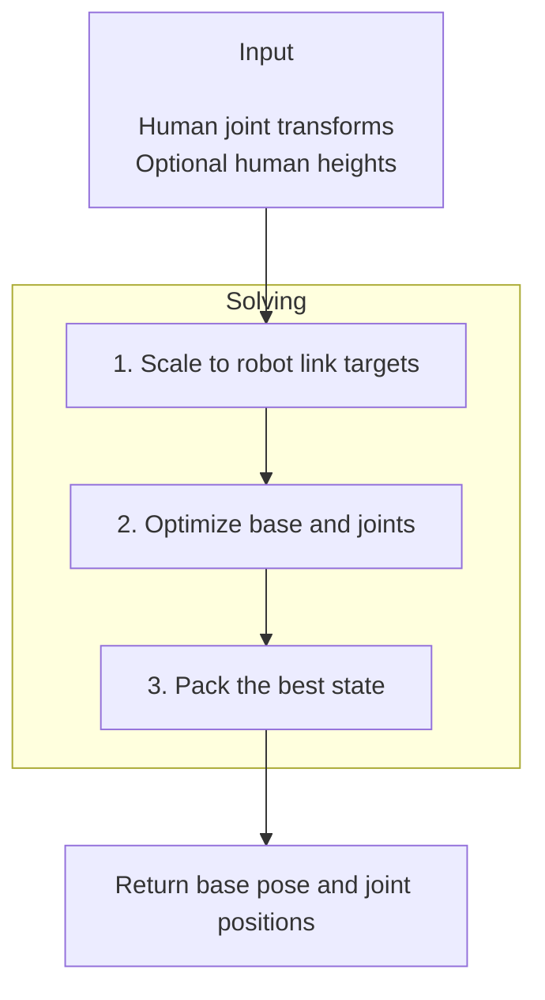

# Humanoid Retargeting

|  |  |
| --- | --- |
| Two-feet jump retargeted to a G1 humanoid. | A cha-cha dance retargeted to a G1 humanoid. |

`robokit.helpers.humanoid_retargeting` maps human motion onto a floating-base humanoid. Online
retargeting solves one frame at a time. Offline retargeting solves a whole trajectory at once.

The snippets assume `robot`, `device`, `motion`, and `human_heights` exist. Complete examples are in
[`src/robokit/examples/humanoid_retargeting`](../../src/robokit/examples/humanoid_retargeting/).

## How Retargeting Works

Each solve scales human joint transforms to robot-link targets by the robot-to-human height
ratio. It then optimizes the floating base and joints and returns the best state.



Poses are 7D `(x, y, z, qw, qx, qy, qz)`. The joint axis follows `retargeter.human_joint_names`.

| Workflow | NumPy input | Output |
| --- | --- | --- |
| Online | `(B, J, 7)` per frame | `(B, 7 + Q)` |
| Offline | `(B, T, J, 7)` | `(B, T, 7 + Q)` |

`B` is batch size, `T` frame count, `J` human joints, and `Q` robot joints. Each output row is the
base pose followed by joint positions. `human_heights` has shape `(B,)`. Omit it to use the
preset's assumed height.

## Presets

A preset is a `HumanoidRetargeterOnlineConfig` for one robot and one human motion source. Presets
exist for the G1, GR3, H1-2, and BHL robots.

```python
# docs: hide
# xdoctest: +SKIP
# docs: endhide
from robokit.helpers.humanoid_retargeting.presets.g1_aligned import g1_aligned  # G1, aligned SMPL-X
from robokit.helpers.humanoid_retargeting.presets.g1_smplh import g1_smplh  # G1, SMPL-H interaction
from robokit.helpers.humanoid_retargeting.presets.g1_offline import g1_offline  # G1 offline optimizer

# docs: hide
assert g1_smplh.interaction_terms
# docs: endhide
```

Derive a variant with `dataclasses.replace(...)`; do not mutate a preset. Costs are tasks in
`config.terms`. Some task weights take a dict keyed by link or joint name.

## Online Retargeting

Online retargeting follows `__init__ → warmup → solve → reset`. The caller owns the frame
loop:

```python
# docs: hide
# xdoctest: +SKIP
import numpy as np
import warp as wp
from robokit.helpers.humanoid_retargeting import HumanoidRetargeterOnline
from robokit.helpers.humanoid_retargeting.presets.g1_aligned import g1_aligned

device = "cuda:0" if wp.is_cuda_available() else "cpu"
robot = g1_aligned.load_robot()
human_heights = np.array([g1_aligned.human_height_assumption], dtype=np.float32)
motion = np.zeros((3, len(g1_aligned.human_joint_names), 7), dtype=np.float32)
motion[..., 3] = 1.0
motion[..., 2] = np.linspace(0.2, 1.6, motion.shape[1])
motion[..., 0] = 0.05 * np.sin(np.arange(motion.shape[1]))
# docs: endhide
from robokit.helpers.humanoid_retargeting import HumanoidRetargeterOnline
from robokit.helpers.humanoid_retargeting.presets.g1_aligned import g1_aligned

retargeter = HumanoidRetargeterOnline(g1_aligned, robot=robot, device=device)
retargeter.warmup(batch_size=1)

for T_world_human in motion:  # one (J, 7) frame per iteration
    qpos = retargeter.solve_numpy(T_world_human[None], human_heights)[0]

retargeter.reset()
# docs: hide
assert qpos.shape == (7 + robot.spec.num_actuated_joints,)
assert np.isfinite(qpos).all()
# docs: endhide
```

Omit `robot` to load it from the config. The first solve captures the CUDA graph. Before a timed
loop, run one throwaway solve and call `reset()`. `solve()` is the Warp API.

Call `reset()` between clips. `reset(T_world_base=...)` also seeds the floating base. Use it when
the first frame is far from the origin; see
[`08_terrain.py`](../../src/robokit/examples/humanoid_retargeting/08_terrain.py).

See [`01_online.py`](../../src/robokit/examples/humanoid_retargeting/01_online.py).

### Online Batches

Call `warmup(batch_size=B)` and pass one `(B, J, 7)` frame per iteration. Streams advance in
lockstep. Repeat the last frame of shorter streams. The batch size is fixed after `warmup`; create
a new retargeter to change it.

See [`06_online_batch.py`](../../src/robokit/examples/humanoid_retargeting/06_online_batch.py).

## Collision Avoidance

Weight the `collision` task and pass your own `WarpScene`:

```python
# docs: hide
# xdoctest: +SKIP
import numpy as np
import warp as wp
from robokit.helpers.humanoid_retargeting import HumanoidRetargeterOnline
from robokit.helpers.humanoid_retargeting.presets.g1_aligned import g1_aligned

device = "cuda:0" if wp.is_cuda_available() else "cpu"
robot = g1_aligned.load_robot()
human_heights = np.array([g1_aligned.human_height_assumption], dtype=np.float32)
motion = np.zeros((3, len(g1_aligned.human_joint_names), 7), dtype=np.float32)
motion[..., 3] = 1.0
motion[..., 2] = np.linspace(0.2, 1.6, motion.shape[1])
motion[..., 0] = 0.05 * np.sin(np.arange(motion.shape[1]))
# docs: endhide
from copy import deepcopy

from robokit.geom import PlaneGeom, WarpScene

config = deepcopy(g1_aligned)
config.task("collision").weight = 1000.0
scene = WarpScene(1, device).add(PlaneGeom(np.array([0, 1], dtype=np.int32)))
retargeter = HumanoidRetargeterOnline(config, scene=scene, device=device)
# docs: hide
retargeter.warmup(batch_size=1)
assert retargeter.config.task("collision").weight == 1000.0
# docs: endhide
```

The `collision` task needs a scene. The `self_collision` task does not. Both need robot collision
spheres; a robot loaded from the config has them. Move obstacles with `geom.update(...)`. The scene
layout is fixed after `warmup`.

See [`02_collision.py`](../../src/robokit/examples/humanoid_retargeting/02_collision.py) and
[`03_self_collision.py`](../../src/robokit/examples/humanoid_retargeting/03_self_collision.py).

## Contact-aware Retargeting

Contact-aware retargeting keeps the human joints' layout relative to points on a moving object.
It needs an interaction preset such as `g1_smplh`, a scene with the object as its only mesh, and
`batch_size=1`. Set the first target before `warmup`. Update it before each solve:

```python
# docs: hide
# xdoctest: +SKIP
import numpy as np
import trimesh
import warp as wp
from robokit.geom import MeshGeom, WarpScene
from robokit.helpers.humanoid_retargeting import HumanoidRetargeterOnline
from robokit.helpers.humanoid_retargeting.presets.g1_smplh import g1_smplh

device = "cuda:0" if wp.is_cuda_available() else "cpu"
robot = g1_smplh.load_robot()
mesh = trimesh.creation.box((0.1, 0.1, 0.1))
scene = WarpScene(1, device).add(MeshGeom([mesh], np.array([0, 1], dtype=np.int32)))
object_points = mesh.vertices.astype(np.float32)
T_world_object_vec7 = np.tile([0, 0, 0, 1, 0, 0, 0], (3, 1)).astype(np.float32)
motion = np.zeros((3, len(g1_smplh.human_joint_names), 7), dtype=np.float32)
motion[..., 3] = 1.0
motion[..., :3] = np.random.default_rng(0).uniform([-0.2, -0.2, 0.2], [0.2, 0.2, 1.6], (3, motion.shape[1], 3))
human_points = motion[..., :3].copy()
# docs: endhide
from robokit.helpers.humanoid_retargeting import build_interaction_mesh_frame

retargeter = HumanoidRetargeterOnline(g1_smplh, robot=robot, scene=scene, device=device)
retargeter.interaction_task.set_frame(
    *build_interaction_mesh_frame(human_points[0], object_points, T_world_object_vec7[0])
)
retargeter.warmup(batch_size=1)

for i, T_world_human in enumerate(motion):
    retargeter.interaction_task.set_frame(
        *build_interaction_mesh_frame(human_points[i], object_points, T_world_object_vec7[i])
    )
    qpos = retargeter.solve_numpy(T_world_human[None])[0]
# docs: hide
assert np.isfinite(qpos).all()
# docs: endhide
```

Move the scene object with `object_geom.update(...)`. Move the interaction target with
`set_frame(...)`. The first target fixes the vertex count.

See [`07_contact.py`](../../src/robokit/examples/humanoid_retargeting/07_contact.py).

## Offline Retargeting

Offline retargeting optimizes all frames jointly. Pass an online mapping config for the targets
and an offline config for the tasks:

```python
# docs: hide
# xdoctest: +SKIP
import numpy as np
import warp as wp
from robokit.helpers.humanoid_retargeting import HumanoidRetargeterOnline
from robokit.helpers.humanoid_retargeting.presets.g1_aligned import g1_aligned

device = "cuda:0" if wp.is_cuda_available() else "cpu"
robot = g1_aligned.load_robot()
human_heights = np.array([g1_aligned.human_height_assumption], dtype=np.float32)
motion = np.zeros((3, len(g1_aligned.human_joint_names), 7), dtype=np.float32)
motion[..., 3] = 1.0
motion[..., 2] = np.linspace(0.2, 1.6, motion.shape[1])
motion[..., 0] = 0.05 * np.sin(np.arange(motion.shape[1]))
from robokit.helpers.humanoid_retargeting import HumanoidRetargeterOffline
from robokit.helpers.humanoid_retargeting.presets.g1_offline import g1_offline
from robokit.helpers.humanoid_retargeting.presets.g1_offline_mapping import g1_offline_mapping

# docs: endhide
from robokit.helpers.humanoid_retargeting import HumanoidRetargeterOffline
from robokit.helpers.humanoid_retargeting.presets.g1_offline import g1_offline
from robokit.helpers.humanoid_retargeting.presets.g1_offline_mapping import g1_offline_mapping

retargeter = HumanoidRetargeterOffline(g1_offline_mapping, g1_offline, device=device)
qpos = retargeter.solve_numpy(motion[None], human_heights=human_heights)[0]  # (T, 7 + Q)
# docs: hide
assert qpos.shape == (3, 7 + robot.spec.num_actuated_joints)
assert np.isfinite(qpos).all()
# docs: endhide
```

The mapping config must not set interaction or correspondence options. Its tasks apply online
only; its velocity limits and output clamp also apply offline. For offline self-collision, add a
`TrajectorySelfCollisionTask` to the offline tasks. `solve_numpy(...)` warms up for its input
shape. The Warp path needs `warmup(batch_size=B, num_frames=T)` before `solve()`.

See [`04_offline.py`](../../src/robokit/examples/humanoid_retargeting/04_offline.py).

### Batch Clips

Pad shorter clips by repeating their last frame. Pass the real lengths:

```python
# docs: hide
# xdoctest: +SKIP
import numpy as np
import warp as wp
from robokit.helpers.humanoid_retargeting import HumanoidRetargeterOnline
from robokit.helpers.humanoid_retargeting.presets.g1_aligned import g1_aligned

device = "cuda:0" if wp.is_cuda_available() else "cpu"
robot = g1_aligned.load_robot()
human_heights = np.array([g1_aligned.human_height_assumption], dtype=np.float32)
motion = np.zeros((3, len(g1_aligned.human_joint_names), 7), dtype=np.float32)
motion[..., 3] = 1.0
motion[..., 2] = np.linspace(0.2, 1.6, motion.shape[1])
motion[..., 0] = 0.05 * np.sin(np.arange(motion.shape[1]))
from robokit.helpers.humanoid_retargeting import HumanoidRetargeterOffline
from robokit.helpers.humanoid_retargeting.presets.g1_offline import g1_offline
from robokit.helpers.humanoid_retargeting.presets.g1_offline_mapping import g1_offline_mapping

retargeter = HumanoidRetargeterOffline(g1_offline_mapping, g1_offline, device=device)
motions = [motion, np.concatenate([motion, motion[-1:]])]
human_heights = np.repeat(human_heights, len(motions))
# docs: endhide
lengths = np.array([len(m) for m in motions], dtype=np.int32)
num_frames = int(lengths.max())
padded = np.stack([np.concatenate([m, np.repeat(m[-1:], num_frames - len(m), axis=0)]) for m in motions])

qpos = retargeter.solve_numpy(padded, valid_lengths=lengths, human_heights=human_heights)
first_clip = qpos[0, : lengths[0]]
# docs: hide
assert first_clip.shape[0] == len(motions[0])
assert np.isfinite(qpos).all()
# docs: endhide
```

See [`05_batch.py`](../../src/robokit/examples/humanoid_retargeting/05_batch.py).
