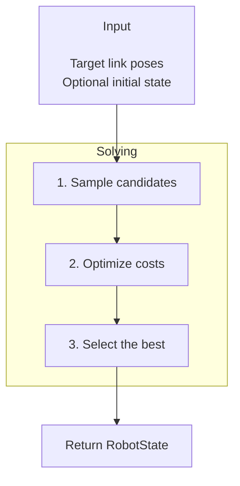

# IK

| An arm tracking a dragged target. | A humanoid tracking hand targets while balancing. |
| --- | --- |

`robokit.helpers.ik` solves inverse kinematics with features including multiple target
links, floating bases, joint limits, smoothness, collision avoidance, and so on.

This tutorial covers the main IK workflows. The snippets assume `robot`, `device`, and
target data are already defined; complete runnable examples and visualizations are in
[`src/robokit/examples/ik`](../../src/robokit/examples/ik/).

## How IK Works

Each solve takes target link poses and an optional initial state, then follows three steps:

1. Sample candidate robot states near the initial state.
2. Run the configured optimizer (Levenberg-Marquardt by default) to reduce pose errors and
   other costs.
3. Keep the best candidates and return them as a `RobotState`.



## Basic IK

An `IKSolver` combines a configuration, a robot, and `target_links`: one name/index or a
sequence of names/indices. Links resolve to indices during construction. `presets.basic`
includes position, rotation, and joint-limit terms.

Pass the target as a translation-first 7D pose:

```python
# docs: hide
import numpy as np
import warp as wp
from robot_descriptions.loaders.yourdfpy import load_robot_description
from robokit.robo import Robot

device = "cpu"
robot = Robot.load(load_robot_description("panda_description"))
q_init = np.mean(robot.spec.actuated_joint_limits, axis=1).astype(np.float32)[None]
# docs: endhide
from robokit.helpers.ik import IKSolver, presets

ik = IKSolver(presets.basic, robot=robot, target_links="panda_hand", device=device)

T_world_target = [0.5, 0.2, 0.5, 0.0, 0.0, 1.0, 0.0]  # x, y, z, qw, qx, qy, qz
state = ik.solve_numpy(T_world_target)
q = state.q.numpy()[0]
# docs: hide
assert q.shape == (robot.spec.num_actuated_joints,)
assert np.isfinite(q).all()
# docs: endhide
```

The first solve builds the solver for its batch size. Call `ik.warmup(batch_size=1)` before
the first solve when that setup cost must happen outside a control loop. Create a new `IK`
to change the batch size.

`solve()` is the Warp-native interface.

### Tracking IK

`presets.smooth` adds a smoothness term. Pass the previous result as both `init_state` and
`prev_state` when solving a moving target:

```python
# docs: hide
import numpy as np
import warp as wp
from robot_descriptions.loaders.yourdfpy import load_robot_description
from robokit.robo import Robot

device = "cpu"
robot = Robot.load(load_robot_description("panda_description"))
q_init = np.mean(robot.spec.actuated_joint_limits, axis=1).astype(np.float32)[None]
from robokit.helpers.ik import IKSolver, IKSolverConfig, presets
from robokit.opt.sampler import RobertsSamplerConfig
from robokit.terms.dense.position_task import PositionTask
from robokit.terms.dense.rotation_task import RotationTask
from robokit.terms.dense.position_limit import PositionLimit
from robokit.terms.dense.smoothness_task import SmoothnessTask

target_trajectory = np.array([[0.5, 0.2, 0.5, 0, 0, 1, 0], [0.5, 0.21, 0.5, 0, 0, 1, 0]], dtype=np.float32)
# docs: endhide
ik = IKSolver(presets.smooth, robot=robot, target_links="panda_hand", device=device)

state = None
for T_world_target in target_trajectory:
    state = ik.solve_numpy(T_world_target, init_state=state, prev_state=state)
# docs: hide
assert np.isfinite(state.q.numpy()).all()
# docs: endhide
```

`init_state` centers the new samples near the previous answer. `prev_state` supplies the
reference for temporal terms and lets the solver keep the previous answer when it scores
better than the new one.

### Custom Terms

Build an `IKSolverConfig` when a preset does not contain the terms you need:

```python
# docs: hide
import numpy as np
import warp as wp
from robot_descriptions.loaders.yourdfpy import load_robot_description
from robokit.robo import Robot

device = "cpu"
robot = Robot.load(load_robot_description("panda_description"))
q_init = np.mean(robot.spec.actuated_joint_limits, axis=1).astype(np.float32)[None]
# docs: endhide
from robokit.helpers.ik import IKContext, IKSolver, IKSolverConfig
from robokit.opt.sampler import RobertsSamplerConfig
from robokit.terms.dense.position_limit import PositionLimit
from robokit.terms.dense.position_task import PositionTask
from robokit.terms.dense.rotation_task import RotationTask
from robokit.terms.dense.smoothness_task import SmoothnessTask

config = (
    IKSolverConfig(sampler=RobertsSamplerConfig(scale=1.0, keep_first=True))
    .add(PositionTask(frame_index=IKContext.TARGET_LINKS, T_world_target=IKContext.TARGET, weight=20.0))
    .add(RotationTask(frame_index=IKContext.TARGET_LINKS, T_world_target=IKContext.TARGET, weight=10.0))
    .add(PositionLimit(weight=50.0))
    .add(SmoothnessTask(prev_var=IKContext.PREVIOUS_STATE, weight=1.0))
)
ik = IKSolver(config, robot=robot, target_links="panda_hand", device=device)
# docs: hide
assert ik.config.task("smoothness_task_0").weight == 1.0
# docs: endhide
```

An argument the solver fills holds an `IKContext` member: `TARGET_LINKS` and `TARGET` are
the target links and the poses passed to `solve`, `PREVIOUS_STATE` is its `prev_state`, and
`REST_Q`/`REST_BASE` are its `rest_state`, `SCENE` is the solver's `scene`, and `SCENE_INDICES` is
the `scene_indices` passed to `solve`. Other terms add constraints or preferences. Use `add_score()` for candidate selection without changing optimization.
Scores normally apply at every selection. Set `solver.rank_final=True` to keep earlier
selections on the optimization cost and return the final candidates in stable score order.

`CompositeTask(tasks, thresholds=[...])` combines constraints and scores. A numeric
threshold requires every absolute residual of that child to pass; `None` makes the
child a weighted score. Passing candidates rank first, with stable input order for ties.
Without `thresholds`, the existing residual concatenation is unchanged. Composite children
read the solver's values like other terms; `num_candidates=IKContext.NUM_SOLUTIONS` groups
candidates by target.

Motion planning uses `FrameTask(residual_mode="distance")` on the solver's targets for translation/angle errors,
`PositionLimit(joint_limits=...)` for explicit bounds, scene collision constraints, and
`ConfigurationTask` for distance ranking.


## Batch IK

Batch IK solves several targets in one call. Add a leading batch dimension to the target
array:

```python
# docs: hide
import numpy as np
from robot_descriptions.loaders.yourdfpy import load_robot_description
from robokit.robo import Robot

# docs: endhide
from robokit.helpers.ik import IKSolver, presets

# docs: hide
device = "cpu"
robot = Robot.load(load_robot_description("panda_description"))
T_world_target_batch = np.tile(np.array([0.5, 0.2, 0.5, 0, 0, 1, 0], dtype=np.float32), (2, 1))
# docs: endhide
ik = IKSolver(presets.smooth, robot=robot, target_links="panda_hand", device=device)
state = ik.solve_numpy(T_world_target_batch)
q_batch = state.q.numpy()
# docs: hide
assert q_batch.shape == (2, robot.spec.num_actuated_joints)
# docs: endhide
```

The output shape is `(batch * ik.num_solutions, dofs)`. All presets return one solution per
target. A custom final stage may retain more; those solutions use instance-major order.

## Multiple Target Links

Pass multiple link names to solve for several links together. Each target row matches the
link at the same position in `links`:

```python
# docs: hide
import numpy as np
import warp as wp
from robot_descriptions.loaders.yourdfpy import load_robot_description
from robokit.robo import Robot

device = "cpu"
robot = Robot.load(load_robot_description("panda_description"))
q_init = np.mean(robot.spec.actuated_joint_limits, axis=1).astype(np.float32)[None]
from robokit.helpers.ik import IKSolver, IKSolverConfig, presets
from robokit.opt.sampler import RobertsSamplerConfig
from robokit.terms.dense.position_task import PositionTask
from robokit.terms.dense.rotation_task import RotationTask
from robokit.terms.dense.position_limit import PositionLimit
from robokit.terms.dense.smoothness_task import SmoothnessTask

robot = Robot.load(load_robot_description("yumi_description"))
initial = robot.forward_kinematics(robot.state())
T_world_target = initial.T_world_link.numpy()[
    0, [robot.spec.link_names.index(name) for name in ("yumi_link_7_r", "yumi_link_7_l")]
]
# docs: endhide
links = ["yumi_link_7_r", "yumi_link_7_l"]
ik = IKSolver(presets.single_candidate, robot=robot, target_links=links, device=device)

# T_world_target: shape (2, 7), or (batch, 2, 7)
state = ik.solve_numpy(T_world_target)
# docs: hide
assert state.q.shape[0] == 1
# docs: endhide
```

To give the links different importance, pass per-link weights to `PositionTask` or
`RotationTask`, such as `weight=[20.0, 5.0]`.

## Floating Base

Set `enable_T_world_base=True` to optimize six base DOFs along with the joints. A value of
zero in `base_active_mask` locks that DOF; the following configuration allows planar base
motion and locks z, roll, and pitch:

```python
# docs: hide
import numpy as np
import warp as wp
from robot_descriptions.loaders.yourdfpy import load_robot_description
from robokit.robo import Robot

device = "cpu"
robot = Robot.load(load_robot_description("panda_description"))
q_init = np.mean(robot.spec.actuated_joint_limits, axis=1).astype(np.float32)[None]
from robokit.helpers.ik import IKContext, IKSolver, IKSolverConfig, presets
from robokit.opt.sampler import RobertsSamplerConfig
from robokit.terms.dense.position_task import PositionTask
from robokit.terms.dense.rotation_task import RotationTask
from robokit.terms.dense.position_limit import PositionLimit
from robokit.terms.dense.smoothness_task import SmoothnessTask

robot = Robot.load(load_robot_description("panda_description"))
state = None
T_world_target = np.array([0.3, 0.0, 0.3, 1, 0, 0, 0], dtype=np.float32)
# docs: endhide
config = (
    IKSolverConfig(
        enable_T_world_base=True,
        sampler=RobertsSamplerConfig(scale=1.0, keep_first=True),
        base_init_sample_range=(1.0, 1.0, 0.0),
        base_active_mask=[1.0, 1.0, 0.0, 0.0, 0.0, 1.0],
    )
    .add(PositionTask(frame_index=IKContext.TARGET_LINKS, T_world_target=IKContext.TARGET, weight=10.0))
    .add(RotationTask(frame_index=IKContext.TARGET_LINKS, T_world_target=IKContext.TARGET, weight=5.0))
    .add(PositionLimit(weight=50.0))
    .add(SmoothnessTask(prev_var=IKContext.PREVIOUS_STATE, weight=0.1, base_weight=0.5))
)
ik = IKSolver(config, robot=robot, target_links="panda_hand", device=device)

state = ik.solve_numpy(T_world_target, init_state=state, prev_state=state)
T_world_base = state.T_world_base.numpy()[0]
# docs: hide
assert T_world_base.shape == (7,)
assert np.isfinite(T_world_base).all()
# docs: endhide
```

`base_init_sample_range` sets the translation noise of each axis around the initial base
pose. Its default `(0.1, 0.1, 0.0)` samples x and y but not z.

## Collision Avoidance

Load the robot with collision spheres, then add scene and self-collision terms:

```python
# docs: hide
# xdoctest: +SKIP
import numpy as np
import warp as wp
from robokit.helpers.ik import IKContext, IKSolver, IKSolverConfig, presets
from robokit.opt.sampler import RobertsSamplerConfig
from robokit.terms.dense.position_task import PositionTask
from robokit.terms.dense.rotation_task import RotationTask
from robokit.terms.dense.position_limit import PositionLimit
from robokit.terms.dense.smoothness_task import SmoothnessTask

device = "cpu"
from robokit.robo import Robot
from robokit.assets.robots.arms import franka_panda
from robokit.geom import BoxGeom, WarpScene

robot = Robot.load(
    franka_panda.URDF_PATH, load_collision_spheres=True, collision_spheres_path=franka_panda.COLLISION_SPHERE_PATH
)
scene = WarpScene(1, device).add(
    BoxGeom(np.array([[0.1, 0.1, 0.1]], dtype=np.float32), np.array([0, 1], dtype=np.int32))
)
# docs: endhide
from robokit.terms.dense.scene_collision_task import SceneCollisionTask
from robokit.terms.dense.self_collision_task import SelfCollisionTask

config = (
    IKSolverConfig(sampler=RobertsSamplerConfig(scale=1.0, keep_first=True), solver=presets.smooth.solver)
    .add(PositionTask(frame_index=IKContext.TARGET_LINKS, T_world_target=IKContext.TARGET, weight=20.0))
    .add(RotationTask(frame_index=IKContext.TARGET_LINKS, T_world_target=IKContext.TARGET, weight=10.0))
    .add(PositionLimit(weight=50.0))
    .add(SmoothnessTask(prev_var=IKContext.PREVIOUS_STATE, weight=1.0))
    .add(SceneCollisionTask(scene=IKContext.SCENE, weight=100.0, margin=0.02))
    .add(SelfCollisionTask(robot, representation="sphere", weight=5.0, margin=0.01))
)
ik = IKSolver(config, robot=robot, target_links="panda_hand", device=device, scene=scene)
# docs: hide
assert ik.config.task("scene_collision_task_0").weight == 100.0
# docs: endhide
```

The margin keeps collision spheres away from obstacles or one another. The scene layout is
fixed after the solver is built. Update existing geometry poses in place; create a new `IK`
only when the layout changes.

## Runtime Changes

Every term receives a name such as `position_task_0`. For terms that support runtime weight
updates, use that name to change the weight without rebuilding the solver:

```python
# docs: hide
import numpy as np
import warp as wp
from robot_descriptions.loaders.yourdfpy import load_robot_description
from robokit.robo import Robot

device = "cpu"
robot = Robot.load(load_robot_description("panda_description"))
q_init = np.mean(robot.spec.actuated_joint_limits, axis=1).astype(np.float32)[None]
from robokit.helpers.ik import IKSolver, IKSolverConfig, presets
from robokit.opt.sampler import RobertsSamplerConfig
from robokit.terms.dense.position_task import PositionTask
from robokit.terms.dense.rotation_task import RotationTask
from robokit.terms.dense.position_limit import PositionLimit
from robokit.terms.dense.smoothness_task import SmoothnessTask

links = ["panda_hand", "panda_leftfinger"]
ik = IKSolver(presets.smooth, robot, links, device=device)
target = robot.forward_kinematics(robot.state(q_init)).T_world_link.numpy()[
    0, [robot.spec.link_names.index(name) for name in links]
]
state = ik.solve_numpy(target)

from robokit.robo.robot_state import RobotState


def proximity_factor(state: RobotState) -> float:
    return 0.5


# docs: endhide
ik.set_weight("position_task_0", 20.0 * proximity_factor(state))
ik.set_weight("rotation_task_0", [0.0, 1.5])  # one weight per target link
# docs: hide
assert np.isfinite(state.q.numpy()).all()
# docs: endhide
```

`set_active_joint_mask()` and `set_active_base_mask()` can also lock DOFs at runtime. Other
structural changes, including links, terms, solver stages, collision margins, and scene
layout, require a new `IK`.
