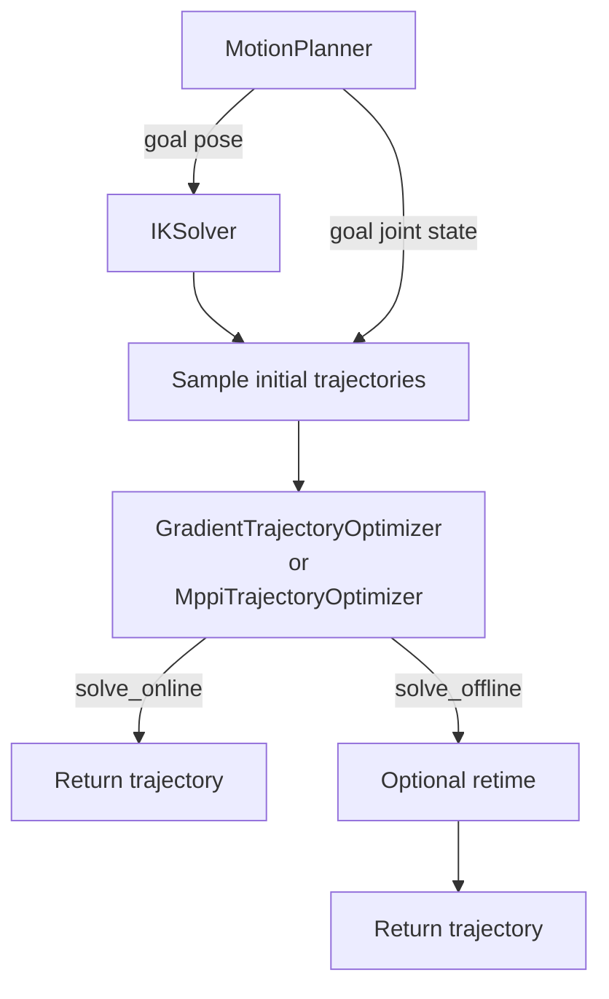

# Motion Planning

|  |  |
| --- | --- |
| Planning around a shelf. | A humanoid reaching around a box while balancing. |

`robokit.helpers.motion_plan` plans a collision-free joint trajectory from a start state to
a goal pose or joint state. Offline planning solves one motion. Batch planning solves several at
once. Online planning updates a trajectory while the robot moves.

The snippets assume `robot`, `scene`, `device`, and `start_q` are defined. Runnable examples and
visualizations are in [`src/robokit/examples/motion_plan`](../../src/robokit/examples/motion_plan/).

## How Planning Works

`MotionPlanner` runs four steps:

1. For a pose goal, `IK` finds goal joint states. A joint goal skips IK.
2. The planner samples initial trajectories from the start to those goals.
3. `GradientTrajectoryOptimizer` or `MppiTrajectoryOptimizer` refines them for the goal,
   collisions, joint limits, and smoothness.
4. `solve_online()` returns the trajectory. `solve_offline()` first retimes it, if the last stage
   sets `retime`.

The trajectory candidate count must be divisible by the IK goal count.



## Basic Example

Plan to a hand pose past a box, then sample the plan at 50 Hz:

```python
# docs: hide
# xdoctest: +SKIP
# docs: endhide
import numpy as np
import warp as wp
from robokit.assets.robots.arms import franka_panda
from robokit.geom import BoxGeom, WarpScene
from robokit.helpers.motion_plan import MotionPlanner, presets
from robokit.robo import Robot

device = "cuda:0" if wp.is_cuda_available() else "cpu"
robot = Robot.load(
    franka_panda.URDF_PATH, load_collision_spheres=True, collision_spheres_path=franka_panda.COLLISION_SPHERE_PATH
)

# A box with half extents (0.04, 0.25, 0.2) m standing in front of the arm.
T_world_box = np.eye(4, dtype=np.float32)[None]
T_world_box[0, :3, 3] = (0.45, 0.0, 0.2)
box = BoxGeom(
    np.array([[0.04, 0.25, 0.2]], np.float32),
    np.array([0, 1], np.int32),
    poses=wp.array(T_world_box, dtype=wp.mat44, device=device),
)
scene = WarpScene(1, device).add(box)
planner = MotionPlanner(presets.offline_pose_lbfgs, robot, "panda_hand", scene=scene, device=device)

start_q = robot.spec.midrange_q.astype(np.float32)
T_world_goal = np.array([0.45, 0.35, 0.25, 0.0, 1.0, 0.0, 0.0], np.float32)  # x, y, z, qw, qx, qy, qz
result = planner.solve_offline_numpy([start_q, {"panda_hand": T_world_goal}])

q_traj = result.q_traj[0]  # planned joint trajectory, (frames, dofs)
motion_time = result.motion_time[0]  # seconds, at the robot's velocity, acceleration and jerk limits
q_control = result.interpolate(0.02)[0]  # one joint sample every 0.02 s, (samples, dofs)
# docs: hide
assert np.isfinite(q_control).all() and motion_time > 0
# docs: endhide
```

The scene layout and batch size are fixed once the planner allocates its buffers. Move obstacles
with `box.update(...)`; build a new planner only when the layout or batch size changes.

## Offline Planning

`solve_offline_numpy()` and `solve_offline_torch()` take a list of waypoints. The first is the start;
the last is the goal. Each waypoint is a joint array `q` or a dict `{link_name: T_world_target}` of
7D poses or 4x4 matrices. Inputs may have a leading batch dimension; see
[Batch Planning](#batch-planning).

### Joint Goals

A joint goal skips goal IK. Use a joint preset:

```python
# docs: hide
# xdoctest: +SKIP
import numpy as np
import warp as wp
from robokit.assets.robots.arms import franka_panda
from robokit.helpers.motion_plan import MotionPlanner, presets
from robokit.robo import Robot

device = "cuda:0" if wp.is_cuda_available() else "cpu"
robot = Robot.load(
    franka_panda.URDF_PATH, load_collision_spheres=True, collision_spheres_path=franka_panda.COLLISION_SPHERE_PATH
)
start_q = robot.spec.midrange_q.astype(np.float32)
target_q = start_q.copy()
target_q[0] += 0.5
# docs: endhide
planner = MotionPlanner(presets.offline_joint_lbfgs, robot, "panda_hand", device=device)
result = planner.solve_offline_numpy([start_q, target_q])
# docs: hide
assert np.isfinite(result.q_traj).all()
# docs: endhide
```

### Waypoints

Waypoints between start and goal can be joint arrays or poses:

```python
# docs: hide
# xdoctest: +SKIP
import numpy as np
import warp as wp
from robokit.assets.robots.arms import franka_panda
from robokit.helpers.motion_plan import MotionPlanner, presets
from robokit.robo import Robot

device = "cuda:0" if wp.is_cuda_available() else "cpu"
robot = Robot.load(
    franka_panda.URDF_PATH, load_collision_spheres=True, collision_spheres_path=franka_panda.COLLISION_SPHERE_PATH
)
start_q = robot.spec.midrange_q.astype(np.float32)
target_q = start_q.copy()
target_q[0] += 0.5
planner = MotionPlanner(presets.offline_joint_lbfgs, robot, "panda_hand", device=device)
# docs: endhide
T_world_mid = np.array([0.5, 0.0, 0.5, 0.0, 1.0, 0.0, 0.0], np.float32)
result = planner.solve_offline_numpy([start_q, {"panda_hand": T_world_mid}, target_q])
q_mid = result.q_traj[:, result.waypoint_indices[1]]
# docs: hide
assert np.isfinite(result.q_traj).all()
# docs: endhide
```

The planner then:

1. Solves IK for each pose waypoint, seeded from its neighbors.
2. Optimizes one trajectory with every waypoint locked on a frame; the robot passes through without stopping.
3. Gives each segment frames by the time it needs (`resplit_waypoints=False` splits them evenly).
4. Retimes the whole trajectory.

`waypoint_indices` gives each waypoint's frame. Pose waypoints name the planner's target links;
`planner.ik` solves their IK alone. [`10_waypoints.py`](../../src/robokit/examples/motion_plan/10_waypoints.py) compares one global
optimization with per-segment ones, and [`12_interpolated_waypoints.py`](../../src/robokit/examples/motion_plan/12_interpolated_waypoints.py)
shows resplitting.

Three options take one entry per segment, waypoint `i` to `i + 1`:

- `segment_check_collision=False` ignores the scene there, e.g. for the final grasp approach of
  `[start_q, pre_grasp_q, grasp_q]` with `(True, False)`.
- `segment_fixed_duration` fixes a segment's time in seconds; `None` segments are retimed. The
  durations must fit in `num_timesteps`.
- `segment_locked=True` keeps a segment on the straight line between its waypoints, e.g. a 1.5 s hold
  while a gripper closes: `segment_fixed_duration=(None, 1.5)`, `segment_locked=(False, True)`.

To plan for some joints only, such as one arm of a bimanual robot, call `set_active_joint_mask` before
the first solve.

### Speed and Control Rate

Offline plans are retimed to the fastest motion within the robot's velocity limits and the
planner's `acceleration_limit` and `jerk_limit`. `RetimeConfig.speed_scale` runs slower: `0.5`
takes twice as long. `result.interpolate(dt, speed_scale)` samples the plan every `dt` seconds and
keeps each waypoint as a sample. Its `speed_scale` slows the plan further without replanning.
[`11_interpolated_speed.py`](../../src/robokit/examples/motion_plan/11_interpolated_speed.py) sets
both with Viser sliders.

## Batch Planning

Batch planning solves several start-goal pairs in one call. Starts and goals get a leading batch
dimension. `scene_indices[i]` picks the collision scene for query `i`; queries and scenes need not
match in number.

Here four queries use two scenes:

```text
query:          0  1  2  3
scene_indices:  0  0  1  1
```

The call is the same:

```python
# docs: hide
# xdoctest: +SKIP
import numpy as np
import warp as wp
from robot_descriptions.loaders.yourdfpy import load_robot_description
from robokit.robo import Robot

device = "cuda:0" if wp.is_cuda_available() else "cpu"
from robokit.assets.robots.arms import franka_panda

robot = Robot.load(
    franka_panda.URDF_PATH, load_collision_spheres=True, collision_spheres_path=franka_panda.COLLISION_SPHERE_PATH
)
start_q = robot.spec.midrange_q.astype(np.float32)
from robokit.geom import BoxGeom, WarpScene
from robokit.helpers.motion_plan import MotionPlanner, presets
from robokit.utils.warp_utils import wp_vec7

# A box away from the arm's starting configuration.
T_world_box = np.eye(4, dtype=np.float32)[None]
T_world_box[:, :3, 3] = [2, 0, 0]
scene = WarpScene(1, device).add(
    BoxGeom(
        np.array([[0.1, 0.1, 0.1]], dtype=np.float32),
        np.array([0, 1], dtype=np.int32),
        poses=wp.array(T_world_box, dtype=wp.mat44, device=device),
    )
)
start_q_batch = np.tile(start_q, (4, 1))
T_world_target_batch = np.tile([0.60, 0.0, 0.40, 0, 1, 0, 0], (4, 1)).astype(np.float32)
scene = WarpScene(2, device).add(
    BoxGeom(
        np.full((2, 3), 0.1, dtype=np.float32),
        np.array([0, 1, 2], dtype=np.int32),
        poses=wp.array(np.repeat(T_world_box, 2, axis=0), dtype=wp.mat44, device=device),
    )
)
# docs: endhide
# start_q_batch: shape (4, dofs)
# T_world_target_batch: shape (4, 7)
scene_indices = np.array([0, 0, 1, 1], dtype=np.int32)

# Here scene is a WarpScene containing scene 0 and scene 1.
planner = MotionPlanner(presets.offline_pose_lm, robot, "panda_hand", scene=scene, device=device)
result = planner.solve_offline_numpy([start_q_batch, {"panda_hand": T_world_target_batch}], scene_indices=scene_indices)

q_traj_batch = result.q_traj
# docs: hide
assert q_traj_batch.shape[0] == 4
assert np.isfinite(q_traj_batch).all()
# docs: endhide
```

For a shared scene, use a one-scene `WarpScene` and fill `scene_indices` with zeros. A scene can
mix boxes, meshes, and other geometry.

## Online Planning

Online planning runs in a control loop. Each step plans from the current state and moves the
robot to the next trajectory frame. Goals and obstacle poses may change before any solve.

MPPI keeps its trajectory between solves. Solve goal IK when the pose target changes and pass the
result as `target_q`.

```python
# docs: hide
# xdoctest: +SKIP
import numpy as np
import warp as wp
from robot_descriptions.loaders.yourdfpy import load_robot_description
from robokit.robo import Robot

device = "cuda:0" if wp.is_cuda_available() else "cpu"
from robokit.assets.robots.arms import franka_panda

robot = Robot.load(
    franka_panda.URDF_PATH, load_collision_spheres=True, collision_spheres_path=franka_panda.COLLISION_SPHERE_PATH
)
start_q = robot.spec.midrange_q.astype(np.float32)
from robokit.geom import BoxGeom, WarpScene
from robokit.helpers.motion_plan import MotionPlanner, presets
from robokit.utils.warp_utils import wp_vec7

# A box away from the arm's starting configuration.
T_world_box = np.eye(4, dtype=np.float32)[None]
T_world_box[:, :3, 3] = [2, 0, 0]
scene = WarpScene(1, device).add(
    BoxGeom(
        np.array([[0.1, 0.1, 0.1]], dtype=np.float32),
        np.array([0, 1], dtype=np.int32),
        poses=wp.array(T_world_box, dtype=wp.mat44, device=device),
    )
)
# docs: endhide
planner = MotionPlanner(presets.online_pose_mppi, robot, "panda_hand", scene=scene, device=device)

current = robot.state(q=wp.array(start_q[None], dtype=wp.float32, device=device))
T_world_target_wp = wp.array(
    [[0.60, 0.0, 0.40, 0.0, 1.0, 0.0, 0.0]],
    dtype=wp_vec7,
    device=device,
)
target_q_wp = wp.clone(
    planner.ik.solve(T_world_target_wp.reshape((1, 1)), init_state=current, rest_state=current).q[:1]
)

online_state = None
for _ in range(20):
    trajectory, online_state = planner.solve_online(
        current,
        T_world_target=T_world_target_wp,
        target_q=target_q_wp,
        online_state=online_state,
    )
    wp.copy(current.q, trajectory.q[:, 1])
    current.invalidate()
# docs: hide
assert np.isfinite(current.q.numpy()).all()
# docs: endhide
```

For L-BFGS, use `presets.online_pose_lbfgs`. It solves pose IK itself, so `target_q` is optional.

To move obstacles, call `geom.update(...)` before the next solve. In tight loops, allocate input
Warp arrays once, outside the loop.

## Customization

### Objectives

Each optimizer stage holds a list of tasks with their weights, margins and limits. Edit a copy of
a preset:

```python
from copy import deepcopy
from robokit.helpers.motion_plan import presets

stage = deepcopy(presets.offline_pose_lm.stages[0])
stage.task("collision").weight = 1000.0
stage.task("collision").margin = 0.03
stage.task("position_limit").dense_task.weight = 200.0
```

For a new objective, list only the tasks you want. Arguments set to a `MotionPlanContext` member,
such as `ctx.TARGET` or `ctx.START_Q`, are filled in for each query:

```python
from robokit.helpers.motion_plan import GradientTrajectoryOptimizerConfig, MotionPlanContext as ctx
from robokit.terms.dense.frame_task import FrameTask
from robokit.terms.sparse.trajectory_smoothness_task import TrajectorySmoothnessTask
from robokit.terms.trajectory_task import TrajectoryTask

target = FrameTask(
    frame_index=ctx.TARGET_LINKS, T_world_target=ctx.TARGET, position_weight=400.0, orientation_weight=200.0
)
stage = GradientTrajectoryOptimizerConfig(
    terms=[
        TrajectoryTask(target, frame_indices=[-1], name="target"),
        TrajectorySmoothnessTask(weight=5.0),
    ]
)
```

Goal IK has its own task list, `config.goal_ik.terms`.

### Point clouds and depth

`SdfVolume.from_mesh`, `from_points`, and `from_depth` build collision grids. Points mark occupied
cells. Depth also marks free space, given the camera `intrinsics` and `T_world_camera` (OpenCV axes:
right, down, forward), so later depth can clear old points. Unknown space is free; pass
`unknown_is_occupied=True` to block it.

```python
# docs: hide
# xdoctest: +REQUIRES(env:ROBOKIT_CUDA_DOCS)
import numpy as np
import warp as wp
from robokit.geom import SdfVolume, VolumeGeom, WarpScene

wp.init()
points = wp.array([[0.0, 0.0, 0.6]], dtype=wp.vec3, device="cuda:0")
depth = wp.full((48, 64), 0.6, dtype=wp.float32, device="cuda:0")
intrinsics = wp.mat33(100, 0, 32, 0, 100, 24, 0, 0, 1)
T_world_camera = wp.mat44(np.eye(4))
# docs: endhide
workspace_min = np.array([-0.2, -0.2, 0.2])
workspace_max = np.array([0.2, 0.2, 1.0])
volume = SdfVolume.from_points(points, workspace_min, workspace_max)
scene = WarpScene(1, "cuda:0").add(VolumeGeom([volume], np.array([0, 1], dtype=np.int32)))
volume.update(depth=depth, intrinsics=intrinsics, T_world_camera=T_world_camera)
```

Pass `scene` to the planner and call `volume.update` as observations arrive; `reset=True` forgets old
ones. Bounds, device and resolution are fixed; to change them, create a new volume and call
`VolumeGeom.update`. Bounds crop observations; they are not walls. Pass device Warp arrays to avoid
uploads. Points alone cannot mark free space, so add calibrated depth when you can.

### Humanoids

`presets.humanoid_offline_lbfgs`, `humanoid_online_lbfgs` and `humanoid_online_mppi` plan both
hands of a floating-base humanoid with its feet planted. Their `feet_position`, `feet_rotation`,
`balance` and `posture` terms are stubs. Fill them in once the standing pose is known, through
`config.goal_ik.task(name)` and `config.stages[0].task(name)`; examples 08 and 09 show how.
Floating-base results also include `T_world_base_traj`.
