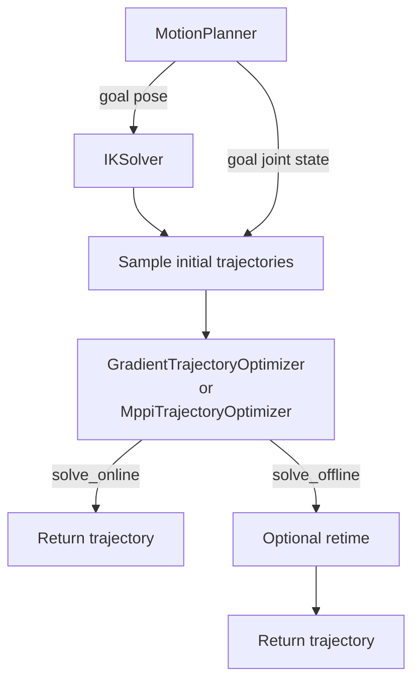

# Motion Planning

| Planning around a shelf. | A humanoid reaching around a box while balancing. |
| --- | --- |

`robokit.helpers.motion_plan` plans a collision-free joint trajectory from a start state to
a goal pose or joint state. Offline planning solves one motion, batch planning solves several
motions together, and online planning repeatedly updates a trajectory while the robot moves.

This tutorial explains each workflow before showing the planner calls that implement it. The
snippets assume `robot`, `scene`, `device`, and `start_q` are already defined; complete runnable
setups and visualizations are in [`src/robokit/examples/motion_plan`](../../src/robokit/examples/motion_plan/).

## How Planning Works

`MotionPlanner` follows one pipeline:

1. For a pose goal, `IK` finds goal joint states. A joint-state goal skips IK.
2. The planner samples initial trajectories from the start state to those goals.
3. `GradientTrajectoryOptimizer` or `MppiTrajectoryOptimizer` refines the trajectories for
   the goal, collisions, joint limits, and smoothness.
4. `solve_online()` returns the trajectory directly. `solve_offline()` first retimes it with
   the last optimizer stage's `retime`, if set.

`MotionPlanner` prepares one IK goal per trajectory candidate before calling the optimizer.
For each batch element, four IK goals and sixteen trajectory candidates assign four consecutive
candidates to each goal. The trajectory candidate count must be divisible by the IK goal count.



## Basic Example

Plan from a start configuration to a hand pose past a box, then sample the plan at a 50 Hz control rate:

```python
# docs: hide
# xdoctest: +REQUIRES(env:ROBOKIT_ASSET_TESTS==1)
# docs: endhide
import numpy as np
import warp as wp
from robokit.assets.robots.arms import franka_panda
from robokit.geom import BoxGeom, WarpScene
from robokit.helpers.motion_plan import MotionPlanner, presets
from robokit.robo import Robot

device = "cuda:0" if wp.is_cuda_available() else "cpu"
robot = Robot.load(
    franka_panda.URDF_PATH, load_collision_spheres=True, collision_spheres_path=franka_panda.COLLISION_SPHERE_PATH
)

# A box with half extents (0.04, 0.25, 0.2) m standing in front of the arm.
T_world_box = np.eye(4, dtype=np.float32)[None]
T_world_box[0, :3, 3] = (0.45, 0.0, 0.2)
box = BoxGeom(
    np.array([[0.04, 0.25, 0.2]], np.float32),
    np.array([0, 1], np.int32),
    poses=wp.array(T_world_box, dtype=wp.mat44, device=device),
)
scene = WarpScene(1, device).add(box)
planner = MotionPlanner(presets.offline_pose_lbfgs, robot, "panda_hand", scene=scene, device=device)

start_q = robot.spec.midrange_q.astype(np.float32)
T_world_goal = np.array([0.45, 0.35, 0.25, 0.0, 1.0, 0.0, 0.0], np.float32)  # x, y, z, qw, qx, qy, qz
result = planner.solve_offline_numpy([start_q, {"panda_hand": T_world_goal}])

q_traj = result.q_traj[0]  # planned joint trajectory, (frames, dofs)
motion_time = result.motion_time[0]  # seconds, at the robot's velocity, acceleration and jerk limits
q_control = result.interpolate(0.02)[0]  # one joint sample every 0.02 s, (samples, dofs)
# docs: hide
assert np.isfinite(q_control).all() and motion_time > 0
# docs: endhide
```

The scene layout and batch size are fixed once the planner allocates its buffers. Move obstacles
with `box.update(...)`; rebuild the planner only when the layout or batch size changes.

## Offline Planning

`solve_offline_numpy()` and `solve_offline_torch()` take an ordered list of waypoints: the first is
the start, the last the goal. Each waypoint is a joint array `q` or a dict `{link_name: T_world_target}`
of 7D poses or 4x4 matrices. Inputs may carry a leading batch dimension, as in
[Batch Planning](#batch-planning).

### Joint Goals

A joint goal skips goal IK, so it takes a joint preset:

```python
# docs: hide
# xdoctest: +REQUIRES(env:ROBOKIT_ASSET_TESTS==1)
import numpy as np
import warp as wp
from robokit.assets.robots.arms import franka_panda
from robokit.helpers.motion_plan import MotionPlanner, presets
from robokit.robo import Robot

device = "cuda:0" if wp.is_cuda_available() else "cpu"
robot = Robot.load(
    franka_panda.URDF_PATH, load_collision_spheres=True, collision_spheres_path=franka_panda.COLLISION_SPHERE_PATH
)
start_q = robot.spec.midrange_q.astype(np.float32)
target_q = start_q.copy()
target_q[0] += 0.5
# docs: endhide
planner = MotionPlanner(presets.offline_joint_lbfgs, robot, "panda_hand", device=device)
result = planner.solve_offline_numpy([start_q, target_q])
# docs: hide
assert np.isfinite(result.q_traj).all()
# docs: endhide
```

### Waypoints

Waypoints between start and goal can be joint arrays or poses:

```python
# docs: hide
# xdoctest: +REQUIRES(env:ROBOKIT_ASSET_TESTS==1)
import numpy as np
import warp as wp
from robokit.assets.robots.arms import franka_panda
from robokit.helpers.motion_plan import MotionPlanner, presets
from robokit.robo import Robot

device = "cuda:0" if wp.is_cuda_available() else "cpu"
robot = Robot.load(
    franka_panda.URDF_PATH, load_collision_spheres=True, collision_spheres_path=franka_panda.COLLISION_SPHERE_PATH
)
start_q = robot.spec.midrange_q.astype(np.float32)
target_q = start_q.copy()
target_q[0] += 0.5
planner = MotionPlanner(presets.offline_joint_lbfgs, robot, "panda_hand", device=device)
# docs: endhide
T_world_mid = np.array([0.5, 0.0, 0.5, 0.0, 1.0, 0.0, 0.0], np.float32)
result = planner.solve_offline_numpy([start_q, {"panda_hand": T_world_mid}, target_q])
q_mid = result.q_traj[:, result.waypoint_indices[1]]
# docs: hide
assert np.isfinite(result.q_traj).all()
# docs: endhide
```

The planner then:

1. Solves IK for each pose waypoint, seeded from its neighbors.
2. Optimizes one trajectory with every waypoint locked on a frame; the robot passes through without stopping.
3. Splits frames by the time each part needs, so a short segment takes fewer: the straight lines' before
   the solve, then the first stage's paths', which the later stages smooth (`resplit_waypoints=False` keeps
   an even split).
4. Retimes the whole trajectory.

`waypoint_indices` gives each waypoint's frame. Pose waypoints become fixed joint configurations
before optimization, by the planner's goal IK resting at the neighboring waypoints; `planner.ik` solves IK alone, best answer
first. Pose waypoints name the planner's target links.
[`10_waypoints.py`](../../src/robokit/examples/motion_plan/10_waypoints.py) compares one global
optimization with per-segment ones, and
[`12_interpolated_waypoints.py`](../../src/robokit/examples/motion_plan/12_interpolated_waypoints.py)
shows resplitting.

Three options take one entry per segment, waypoint `i` to `i + 1`:

- `segment_check_collision`: False drops world collision there, so a grasp may touch the scene:
  `[start_q, pre_grasp_q, grasp_q]` with `(True, False)` plans a collision-free path to the
  pre-grasp and a free final approach.
- `segment_fixed_duration`: seconds fix a segment's time. It gets `round(duration / dt)` frames in the
  solve, so its neighbors are smoothed against its true speed, keeps them through the resplit, and
  `interpolate` plays it over that time; None segments share the remaining frames and are retimed. The
  durations must fit in `num_timesteps`, and fill it when every segment has one.
- `segment_locked`: True keeps the segment's frames on the straight line between its waypoints,
  e.g. a 1.5 s hold while a gripper closes: `segment_fixed_duration=(None, 1.5)`, `segment_locked=(False, True)`.

`set_active_joint_mask` before the first solve also limits collision Jacobians to the active joints, e.g. one arm of
a bimanual model. Fewer queries than the planner's first batch are padded to it.

### Speed and Control Rate

Offline plans are retimed to the fastest motion the robot's velocity limits and the planner's
`acceleration_limit` and `jerk_limit` allow,
with one step for every frame. `RetimeConfig.speed_scale` runs at a fraction of that speed: `0.5`
takes twice as long. `result.interpolate(dt, speed_scale)` samples a plan every `dt` seconds, with
each waypoint among the samples; its `speed_scale` slows the plan further without replanning.
[`11_interpolated_speed.py`](../../src/robokit/examples/motion_plan/11_interpolated_speed.py) sets
both with Viser sliders.

## Batch Planning

Batch planning solves several start-goal pairs in one call. Starts and goals gain a leading
batch dimension, while `scene_indices[i]` selects the collision scene used by query `i`.
The number of queries and the number of scenes are independent.

For example, the following batch contains four planning queries routed to two scenes:

```text
query:          0  1  2  3
scene_indices:  0  0  1  1
```

The planning call itself does not change:

```python
# docs: hide
# xdoctest: +REQUIRES(env:ROBOKIT_ASSET_TESTS==1)
import numpy as np
import warp as wp
from robot_descriptions.loaders.yourdfpy import load_robot_description
from robokit.robo import Robot

device = "cuda:0" if wp.is_cuda_available() else "cpu"
from robokit.assets.robots.arms import franka_panda

robot = Robot.load(
    franka_panda.URDF_PATH, load_collision_spheres=True, collision_spheres_path=franka_panda.COLLISION_SPHERE_PATH
)
start_q = robot.spec.midrange_q.astype(np.float32)
from robokit.geom import BoxGeom, WarpScene
from robokit.helpers.motion_plan import MotionPlanner, presets
from robokit.utils.warp_utils import wp_vec7

# A box away from the arm's starting configuration.
T_world_box = np.eye(4, dtype=np.float32)[None]
T_world_box[:, :3, 3] = [2, 0, 0]
scene = WarpScene(1, device).add(
    BoxGeom(
        np.array([[0.1, 0.1, 0.1]], dtype=np.float32),
        np.array([0, 1], dtype=np.int32),
        poses=wp.array(T_world_box, dtype=wp.mat44, device=device),
    )
)
start_q_batch = np.tile(start_q, (4, 1))
T_world_target_batch = np.tile([0.60, 0.0, 0.40, 0, 1, 0, 0], (4, 1)).astype(np.float32)
scene = WarpScene(2, device).add(
    BoxGeom(
        np.full((2, 3), 0.1, dtype=np.float32),
        np.array([0, 1, 2], dtype=np.int32),
        poses=wp.array(np.repeat(T_world_box, 2, axis=0), dtype=wp.mat44, device=device),
    )
)
# docs: endhide
# start_q_batch: shape (4, dofs)
# T_world_target_batch: shape (4, 7)
scene_indices = np.array([0, 0, 1, 1], dtype=np.int32)

# Here scene is a WarpScene containing scene 0 and scene 1.
planner = MotionPlanner(presets.offline_pose_lm, robot, "panda_hand", scene=scene, device=device)
result = planner.solve_offline_numpy([start_q_batch, {"panda_hand": T_world_target_batch}], scene_indices=scene_indices)

q_traj_batch = result.q_traj
# docs: hide
assert q_traj_batch.shape[0] == 4
assert np.isfinite(q_traj_batch).all()
# docs: endhide
```

For a shared scene, use a one-scene `WarpScene` and fill `scene_indices` with zeros. A scene
may combine boxes, meshes, and other geometry types; the per-query mapping remains the same.

## Online Planning

Online planning runs in a control loop. Each iteration plans from the current robot state,
executes the next trajectory waypoint, and uses that new state for the next iteration.
Goals and obstacle poses may be updated before every solve.

MPPI retains its trajectory and action distribution between updates. The caller solves goal IK
when the pose target changes and passes that joint goal into each planning update.

```python
# docs: hide
# xdoctest: +REQUIRES(env:ROBOKIT_ASSET_TESTS==1)
import numpy as np
import warp as wp
from robot_descriptions.loaders.yourdfpy import load_robot_description
from robokit.robo import Robot

device = "cuda:0" if wp.is_cuda_available() else "cpu"
from robokit.assets.robots.arms import franka_panda

robot = Robot.load(
    franka_panda.URDF_PATH, load_collision_spheres=True, collision_spheres_path=franka_panda.COLLISION_SPHERE_PATH
)
start_q = robot.spec.midrange_q.astype(np.float32)
from robokit.geom import BoxGeom, WarpScene
from robokit.helpers.motion_plan import MotionPlanner, presets
from robokit.utils.warp_utils import wp_vec7

# A box away from the arm's starting configuration.
T_world_box = np.eye(4, dtype=np.float32)[None]
T_world_box[:, :3, 3] = [2, 0, 0]
scene = WarpScene(1, device).add(
    BoxGeom(
        np.array([[0.1, 0.1, 0.1]], dtype=np.float32),
        np.array([0, 1], dtype=np.int32),
        poses=wp.array(T_world_box, dtype=wp.mat44, device=device),
    )
)
# docs: endhide
planner = MotionPlanner(presets.online_pose_mppi, robot, "panda_hand", scene=scene, device=device)

current = robot.state(q=wp.array(start_q[None], dtype=wp.float32, device=device))
T_world_target_wp = wp.array(
    [[0.60, 0.0, 0.40, 0.0, 1.0, 0.0, 0.0]],
    dtype=wp_vec7,
    device=device,
)
target_q_wp = wp.clone(
    planner.ik.solve(T_world_target_wp.reshape((1, 1)), init_state=current, rest_state=current).q[:1]
)

online_state = None
for _ in range(20):
    trajectory, online_state = planner.solve_online(
        current,
        T_world_target=T_world_target_wp,
        target_q=target_q_wp,
        online_state=online_state,
    )
    wp.copy(current.q, trajectory.q[:, 1])
    current.invalidate()
# docs: hide
assert np.isfinite(current.q.numpy()).all()
# docs: endhide
```

For L-BFGS, use `presets.online_pose_lbfgs`. It can solve pose IK internally, so `target_q` may be
omitted.

For moving environments, update geometry with `geom.update(...)` before the next solve. Tight
control loops should preallocate their input Warp arrays instead of allocating them inside the loop.

## Customization

### Objectives

Each optimizer stage holds a list of tasks; weights, collision margins and limits live on them.
Edit a copy of a preset:

```python
from copy import deepcopy
from robokit.helpers.motion_plan import presets

stage = deepcopy(presets.offline_pose_lm.stages[0])
stage.task("collision").weight = 1000.0
stage.task("collision").margin = 0.03
stage.task("position_limit").dense_task.weight = 200.0
```

For a new objective, list only the tasks you want. An argument set to a `MotionPlanContext` member,
such as `ctx.TARGET` or `ctx.START_Q`, is filled by the stage for each query:

```python
from robokit.helpers.motion_plan import GradientTrajectoryOptimizerConfig, MotionPlanContext as ctx
from robokit.terms.dense.frame_task import FrameTask
from robokit.terms.sparse.trajectory_smoothness_task import TrajectorySmoothnessTask
from robokit.terms.trajectory_task import TrajectoryTask

target = FrameTask(
    frame_index=ctx.TARGET_LINKS, T_world_target=ctx.TARGET, position_weight=400.0, orientation_weight=200.0
)
stage = GradientTrajectoryOptimizerConfig(
    terms=[
        TrajectoryTask(target, frame_indices=[-1], name="target"),
        TrajectorySmoothnessTask(weight=5.0),
    ]
)
```

Goal IK has its own task list, `config.goal_ik.terms`.

### Point clouds and depth

`SdfVolume.from_mesh`, `from_points`, and `from_depth` construct collision grids.
XYZ samples mark occupied cells; depth supplies free-space evidence and fuses
projective distances using camera intrinsics and `T_world_camera` (OpenCV axes:
right, down, forward). Both input types can update the same volume. Points add
occupied cells; subsequent depth observations may clear them. Unknown space is
free by default; use `unknown_is_occupied=True` on each update to block it.

```python
# docs: hide
# xdoctest: +REQUIRES(env:ROBOKIT_CUDA_DOCS)
import numpy as np
import warp as wp
from robokit.geom import SdfVolume, VolumeGeom, WarpScene

wp.init()
points = wp.array([[0.0, 0.0, 0.6]], dtype=wp.vec3, device="cuda:0")
depth = wp.full((48, 64), 0.6, dtype=wp.float32, device="cuda:0")
intrinsics = wp.mat33(100, 0, 32, 0, 100, 24, 0, 0, 1)
T_world_camera = wp.mat44(np.eye(4))
# docs: endhide
workspace_min = np.array([-0.2, -0.2, 0.2])
workspace_max = np.array([0.2, 0.2, 1.0])
volume = SdfVolume.from_points(points, workspace_min, workspace_max)
scene = WarpScene(1, "cuda:0").add(VolumeGeom([volume], np.array([0, 1], dtype=np.int32)))
volume.update(depth=depth, intrinsics=intrinsics, T_world_camera=T_world_camera)
```

Pass `scene` to the planner. Updates preserve volume IDs and captured collision
graphs; `reset=True` forgets old observations. Fusion options apply per call.
Bounds, device and resolution stay fixed; create a new volume and call
`VolumeGeom.update` to change them. Bounds crop observations rather than forming
workspace walls. All updates use Warp jump flooding with two refinement passes
(approximate distances); there is no CPU EDT path. Pass device Warp arrays
(`vec3` points or a 2D `float32` depth image) to avoid input uploads. Intrinsics
and camera transforms also accept `wp.mat33` and `wp.mat44`; transforms must be
rigid. Save/load preserves fusion history. Keep calibration with partial clouds:
XYZ alone cannot identify free space.

### Humanoids

`presets.humanoid_offline_lbfgs`, `humanoid_online_lbfgs` and `humanoid_online_mppi` plan both hands of a
floating-base humanoid (`goal_ik.enable_T_world_base=True`) with its feet planted. Their named
`feet_position`, `feet_rotation`, `balance` and `posture` terms are stubs to complete once the standing pose is
known, through `config.goal_ik.task(name)` and `config.stages[0].task(name)`; examples 08 and 09 show how.
Floating-base results also carry `T_world_base_traj`.
