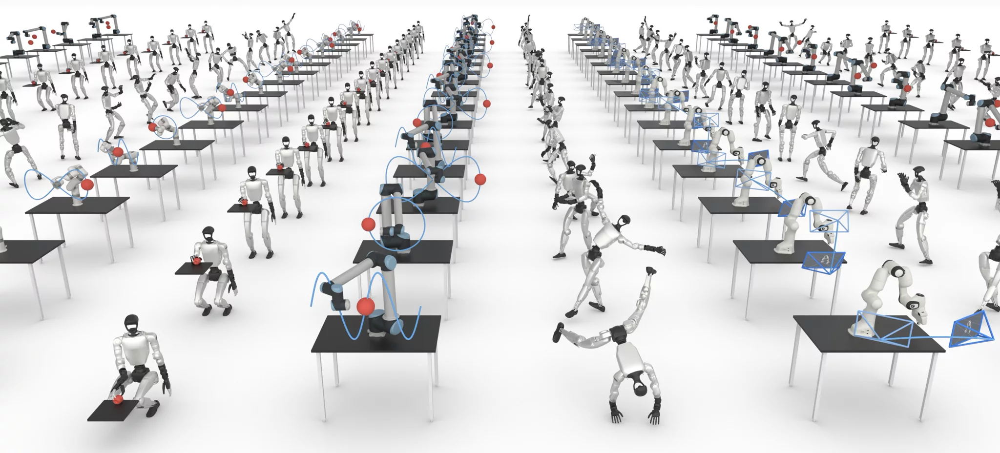
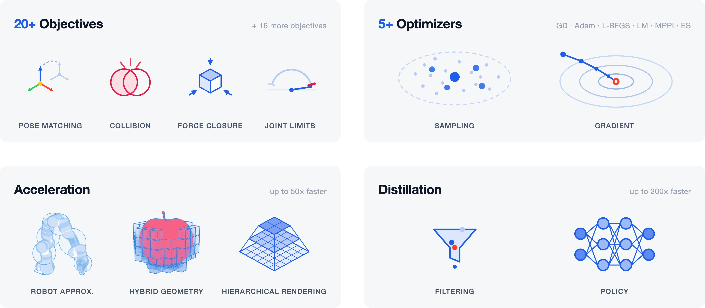
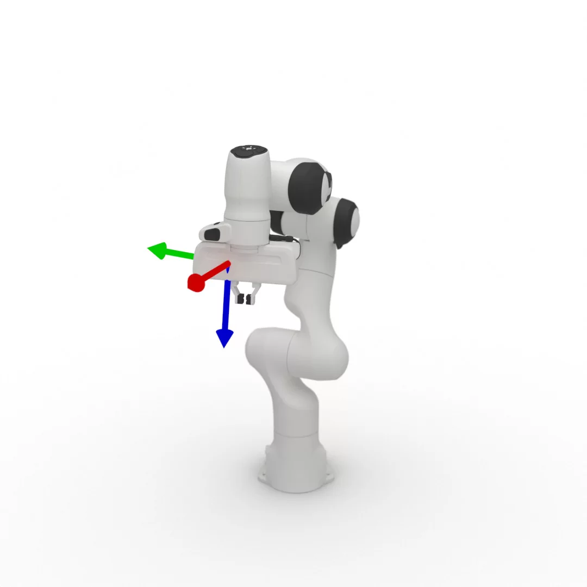
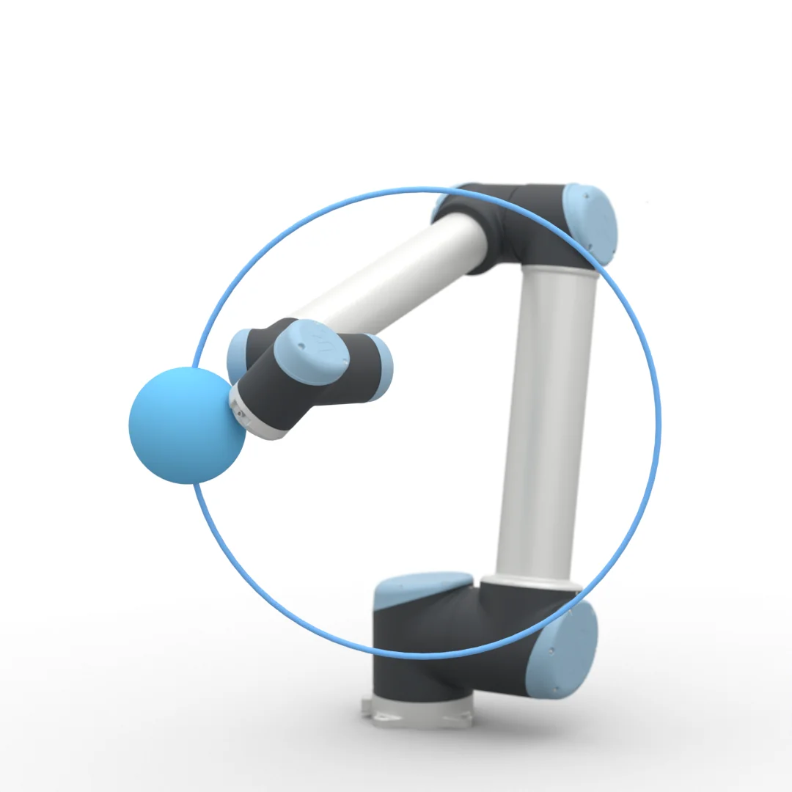
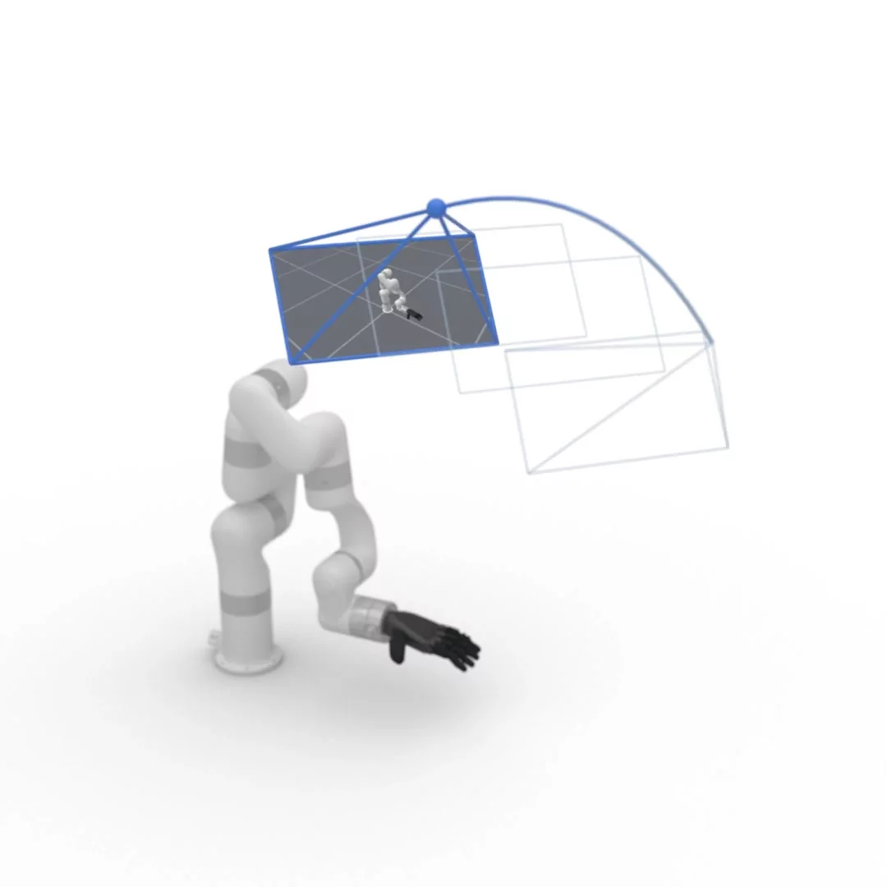
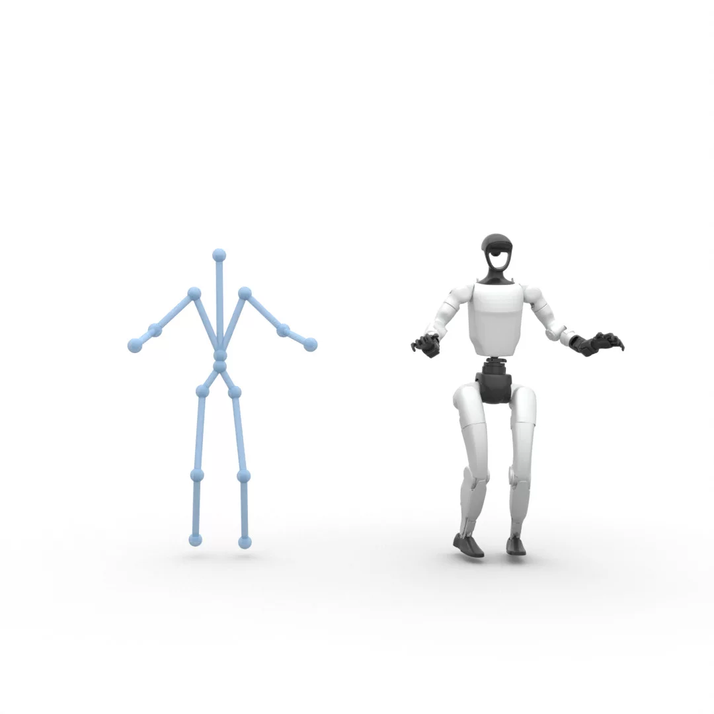
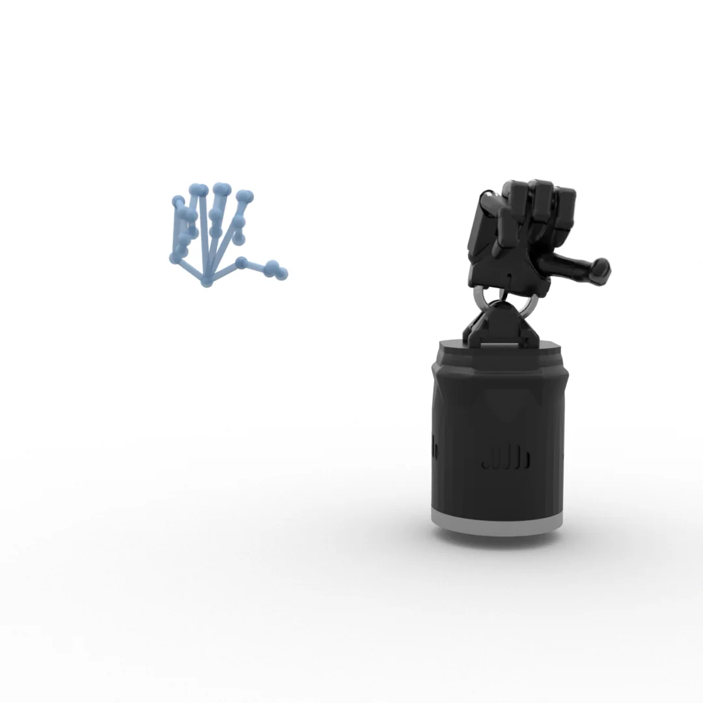
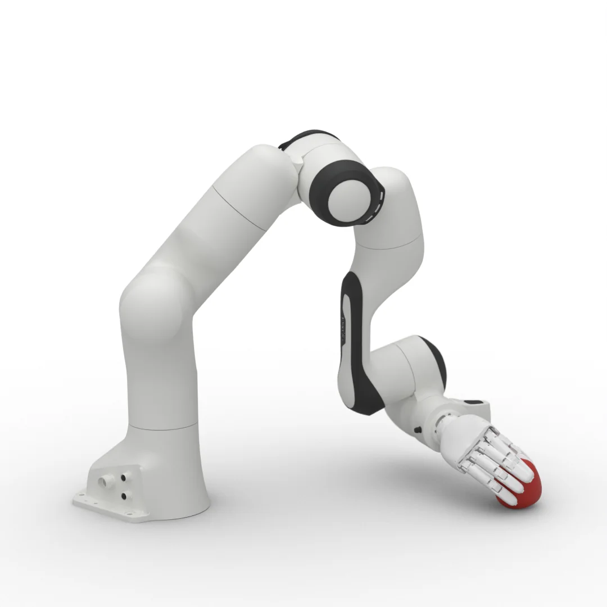

RoboKit is a high-performance, general-purpose toolkit for versatile robotic tasks. It scales
from one problem to thousands in parallel. It provides a library of cost terms and optimizers
that compose freely. Built-in tasks such as IK, motion planning, and retargeting are validated on
real robots.

## Key features

- **Scalable.** One problem or thousands of seeds, solved in one call. Sparse Jacobians scale
  to long trajectories.
- **Composable.** Any cost term works with any optimizer. Pick Gauss-Newton for IK and
  L-BFGS for trajectories, and reuse the same terms in both.
- **Geometry and rendering.** Built for uncompromising performance. Hybrid voxel-mesh SDF queries and
  coarse-to-fine collision and rendering schedules cut the cost of every iteration.
- **GPU-accelerated.** Every kernel is written in [Warp](https://github.com/NVIDIA/warp), a
  significant speedup over prior frameworks.
- **Any robot.** URDF or MJCF, fixed or floating base, mimic joints. Curated models ship with
  [collision spheres](assets.md).
- **Differentiable.** Gradients flow through kinematics and every cost. Terms plug into Torch,
  so optimization can be distilled into policies.

## How it works



| Component | Role | Read more |
| --- | --- | --- |
| Robot | Load URDF or MJCF models and compute batched, differentiable kinematics. | [Robot](../concepts/robot.md) |
| Objectives | Cost terms that define a task: pose matching, collision, limits, contacts. | [Terms](../reference/api/terms.md) |
| Optimizers | Sampling and gradient methods that minimize the objectives in parallel. | [Optimization](../concepts/optimization.md) |
| Acceleration | Fast geometry and rendering for contact-rich and calibration tasks. | [Geometry](../concepts/geom.md) |
| Distillation | Train policies on solver outputs for even faster inference. | |

## Built-in tasks

| [](ik.md) | [](motion_planning.md) | [](hand_eye_calibration.md) |
| --- | --- | --- |
| **[IK](ik.md)** Multi-link targets, fixed or floating base. | **[Motion Planning](motion_planning.md)** Collision-free trajectories, offline or online. | **[Hand-Eye Calibration](hand_eye_calibration.md)** Camera pose from rendered robot masks. |
| [](humanoid_retargeting.md) | [](hand_retargeting.md) | [](../../src/robokit/examples/grasp/) |
| **[Humanoid Retargeting](humanoid_retargeting.md)** Human motion capture to a humanoid. | **[Hand Retargeting](hand_retargeting.md)** Human hand motion to a robot hand. | **[Grasp Optimization](../../src/robokit/examples/grasp/)** Force-closure grasps for any hand or body. |

## Quick links

- [Quickstart](quickstart.md)
- [Installation](installation.md)
- [GitHub](https://github.com/openrobokit/robokit)

## Citation

```bibtex
@inproceedings{ye2026robokit,
  title     = {RoboKit: Accelerating Parallel Differentiable Optimization for Robot Learning},
  author    = {Ye, Jianglong and Peng, Xuanbin and Mc Gartoll, Conor and Jing, Changwei and Wei, Lai and Chen, Jiali and Zou, Xueyan and Wang, Xiaolong},
  booktitle = {Conference on Robot Learning (CoRL)},
  year      = {2026}
}
```
