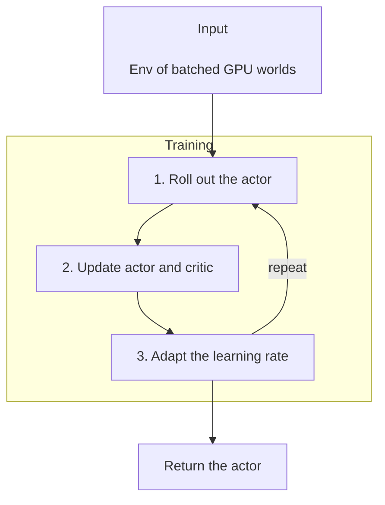

# RL

|  |  |
| --- | --- |
| A G1 tracks a LAFAN1 dance. | A Go1 follows joystick commands. |

`robokit.helpers.rl` trains policies on batched GPU simulations, with features including PPO, CUDA-graphed
updates, and coarse-to-fine physics.

This tutorial covers the main RL workflows. The examples' envs run on
[MuJoCo Warp](https://github.com/google-deepmind/mujoco_warp) (`MjWarpSim`); install it with the `mj` and `mjwarp`
[extras](installation.md#extras), and PyTorch with a `pt-*` extra. Complete runnable examples are in
[`src/robokit/examples/rl`](../../src/robokit/examples/rl/).

## How RL Works

Each PPO update follows three steps:

1. Roll the actor out for `horizon` steps in every world of the env.
2. Update the actor and the critic on that rollout over several epochs.
3. Adapt the learning rate to the policy's KL divergence.



The env's tensors stay on the GPU, so no step waits for the host. After a few warm-up updates, each
update replays as one CUDA graph.

## Environments

An env implements `Env`: `n` worlds, the actor's and the critic's observation sizes (`obs_dims`), the action
`bound`, and the `names` of its reward terms. Its methods take and return GPU tensors:

| Method | What it does |
| --- | --- |
| `obs()` | Returns the actor's and the critic's observations. |
| `step(action)` | Acts; returns the reward, terminated and truncated flags per world, and each reward term's mean. |
| `reset(mask)` | Resets the masked worlds. |
| `curriculum(step)` | Moves the curriculum to `step` env steps. |

The examples wrap `MjWarpSim` worlds and read `sim.data.torch.qpos`, `qvel` and `ctrl`, zero-copy torch views.

## Basic PPO

A `PPO` holds an actor and a critic. Each `update(env)` rolls out once and updates once; the caller owns
the loop. This trains on a toy env where actions near zero pay:

```python
# docs: hide
# xdoctest: +REQUIRES(env:ROBOKIT_CUDA_DOCS==1,module:torch)
from types import SimpleNamespace

import torch

obs, done = torch.zeros(64, 3, device="cuda"), torch.zeros(64, dtype=torch.bool, device="cuda")
env = SimpleNamespace(
    n=64,
    obs_dims=(3, 3),
    bound=torch.ones(2, device="cuda"),
    names=["effort"],
    obs=lambda: (obs, obs),
    step=lambda a: (-(a**2).sum(1), done, done, (a**2).mean()[None]),
    reset=id,
    curriculum=id,
)
# docs: endhide
from robokit.helpers.rl import ppo

learner = ppo.PPO(env.obs_dims, len(env.bound), ppo.PPOConfig())
for _ in range(10):
    learner.update(env)

score = ppo.evaluate(env, learner.actor, steps=100)  # each reward term's mean per step, and terminations
# docs: hide
assert set(score) == {"effort", "terminations"}
# docs: endhide
```

`learner.actor(obs)` returns the mean action. `PPOConfig` holds the PPO settings, such as `horizon`, `epochs`, `minibatches`, `lr`, `kl`, `entropy`, and `hidden`.

### Coarse-to-Fine Training

A policy can train on cheaper physics first. Build the coarse env's scene with `MjWarpSim.build_coarse_spec` and a
`CoarseConfig`, then let `train` mix it in: over the first half of the time, an update draws it with a chance falling to 0.

```python
# docs: hide
# xdoctest: +SKIP
# docs: endhide
actor = learner.train(fine, minutes, coarse_env=coarse, coarse=0.5)
```

## Examples

| Example | Task |
| --- | --- |
| [`01_joystick.py`](../../src/robokit/examples/rl/01_joystick.py) | A Go1 or G1 tracks twist commands. |
| [`02_rough_joystick.py`](../../src/robokit/examples/rl/02_rough_joystick.py) | A Go1 or G1 tracks twist commands on rough terrain. |
| [`03_lift.py`](../../src/robokit/examples/rl/03_lift.py) | A Yam arm carries a cube to random targets. |
| [`04_go1_getup.py`](../../src/robokit/examples/rl/04_go1_getup.py) | A Go1 stands up from a random pose. |
| [`05_panda_pick.py`](../../src/robokit/examples/rl/05_panda_pick.py) | A Panda picks up a cube and brings it to a target. |
| [`06_leap_reorient.py`](../../src/robokit/examples/rl/06_leap_reorient.py) | A LEAP hand turns a cube to goal after goal. |
| [`07_aloha_handover.py`](../../src/robokit/examples/rl/07_aloha_handover.py) | Two ALOHA arms pass a box between grippers. |
| [`08_g1_tracking.py`](../../src/robokit/examples/rl/08_g1_tracking.py) | A G1 tracks a LAFAN1 dance. |
| [`09_go1_handstand.py`](../../src/robokit/examples/rl/09_go1_handstand.py) | A Go1 balances on its front feet. |
| [`10_h1_gait.py`](../../src/robokit/examples/rl/10_h1_gait.py) | An H1 walks at a commanded step rate and swing height. |
| [`11_aloha_peg.py`](../../src/robokit/examples/rl/11_aloha_peg.py) | Two ALOHA arms push a peg into a socket. |
| [`12_panda_cabinet.py`](../../src/robokit/examples/rl/12_panda_cabinet.py) | A Panda pulls a drawer open. |
| [`13_cartpole.py`](../../src/robokit/examples/rl/13_cartpole.py) | A cart swings up and balances a pole. |
| [`14_nist_assembly.py`](../../src/robokit/examples/rl/14_nist_assembly.py) | A Panda inserts pegs and meshes gears on the NIST assembly board. |

Run one with `uv run src/robokit/examples/rl/13_cartpole.py swingup --minutes 1`.
