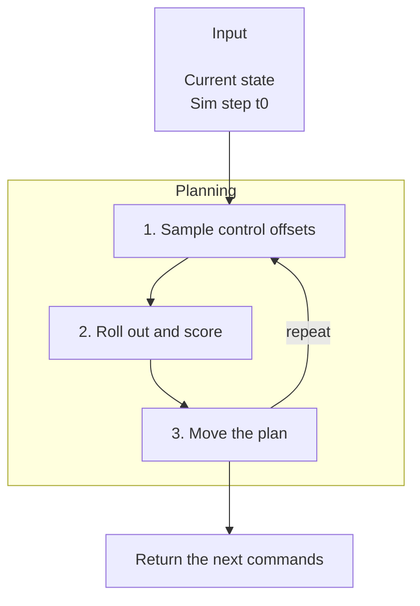

# Sim MPC

|  |  |
| --- | --- |
| A G1 lifts and carries a box. | A Sharpa hand spins a pen in its fingers. |

`robokit.helpers.sim_mpc` is sampling MPC in simulation, with features including motion-capture
tracking, legged gaits, hand-object manipulation, pushing, and batched scenes.

This tutorial covers the main SimMPC workflows. Rollouts run in
[MuJoCo Warp](https://github.com/google-deepmind/mujoco_warp) (`MjWarpSim`) or
[Newton](https://github.com/newton-physics/newton) (`robokit.sim.newton.NewtonSim`); install MuJoCo Warp with
the `mj` and `mjwarp` [extras](installation.md#extras). Complete runnable examples are in [`src/robokit/examples/sim_mpc`](../../src/robokit/examples/sim_mpc/).

## How SimMPC Works

Each `plan(data, t0)` starts from the given state, then follows four steps:

1. Sample control offsets around the current plan; draw zero is the plan itself.
2. Roll every draw out in parallel worlds for `horizon_steps` and sum its costs.
3. Move the plan toward the low-cost draws, until it stops improving or reaches `max_iterations`.
4. Return the first `ctrl_steps` commands and shift the plan forward.



Controls are `ctrl_ref` plus offsets interpolated between nodes every `node_steps` sim steps. The
sampler is robokit's MPPI, the one motion planning runs. SimMPC runs on the current Warp device; on a
CUDA GPU every sim step replays a captured CUDA graph, and the CPU is much slower.

## Basic SimMPC

A `SimMPC` combines a `SimMPCConfig`, a planning simulator, and `ctrl_ref`. This drives a cart on a
slide joint from `x = 0` to `x = 0.3`:

```python
# docs: hide
# xdoctest: +REQUIRES(env:ROBOKIT_CUDA_DOCS==1,module:mujoco_warp)
# docs: endhide
import mujoco
import numpy as np
from robokit.helpers.sim_mpc import SimMPC, SimMPCConfig
from robokit.sim import MjWarpSim
from robokit.terms import SensorTask

model = mujoco.MjModel.from_xml_string("""
<mujoco>
  <option timestep="0.01"/>
  <worldbody>
    <body name="cart">
      <joint name="x" type="slide" axis="1 0 0" damping="5"/>
      <geom type="box" size="0.05 0.05 0.05" mass="1"/>
    </body>
  </worldbody>
  <actuator><position joint="x" kp="50"/></actuator>
  <sensor><jointpos name="x" joint="x"/></sensor>
</mujoco>
""")
data = mujoco.MjData(model)
mujoco.mj_forward(model, data)

steps = 100
config = SimMPCConfig(num_samples=64, horizon_steps=30, node_steps=10, ctrl_steps=10, max_iterations=4, ctrl_std=0.1)
ctrl_ref = np.zeros((steps + config.horizon_steps, model.nu))  # a row for every step a horizon reaches
sensor_ref = np.full((len(ctrl_ref), model.nsensordata), 0.3)
config.add(SensorTask(sensor_ref, weight={"x": 100.0}))
mpc = SimMPC(config, MjWarpSim(model, 1, data), ctrl_ref)  # plans on resized copies of this simulator
(rollout,), (plans,) = mpc.execute(MjWarpSim(model, 1, data), steps)  # one rollout and one plan list per instance

qpos = rollout["qpos"]  # (steps, nq), row k is the state at sim step k
# docs: hide
assert qpos.shape == (steps, model.nq) and rollout["ctrl"].shape == (steps, model.nu)
assert abs(qpos[-1, 0] - 0.3) < 0.05, qpos[-1, 0]
# docs: endhide

# or execute the commands yourself, here in MuJoCo on the CPU
mpc = SimMPC(config, MjWarpSim(model, 1, data), ctrl_ref)
for t0 in range(0, steps, config.ctrl_steps):
    commands, infos = mpc.plan(data, t0)  # (ctrl_steps, batch_size, nu); the plan then shifts by ctrl_steps
    for command in commands.numpy()[:, 0]:
        data.ctrl[:] = command
        mujoco.mj_step(model, data)
# docs: hide
assert abs(data.qpos[0] - 0.3) < 0.05, data.qpos[0]
# docs: endhide
```

`execute(sim, num_steps)` runs the closed loop on `sim` and returns each instance's executed `time`,
`qpos`, `qvel`, `sensordata` and `ctrl` at every sim step, plus one info dict per plan. `plan(data, t0)`
takes a simulator's `data` or one `mujoco.MjData`; `t0` indexes `ctrl_ref` and the references.

`ctrl_std` sets each actuator's sampling noise, and `ctrl_range` bounds the commands (default: the
actuator ranges). SimMPC resizes the planning simulator into its worlds, so size its contact buffers
up front: `MjWarpSim(model, 1, data, nconmax=..., njmax=...)`.

## Costs

A cost is a `robokit.terms` task that reads the simulator's arrays after each step. Row `k` of a
reference array describes sim step `k`, matching the rows `execute` returns.

| Term | Per step |
| --- | --- |
| `StateTask(qpos_ref, qvel_ref, dof_weight)` | Weighted `qpos` and `qvel` error to the reference. |
| `SensorTask(sensor_ref, weight)` | Weighted error of the named sensors to the reference. |
| `ControlTask(weight, ctrl_ref)` | Weighted squared deviation of the controls from `ctrl_ref`. |
| `AlignTask(origin, sensor, target_ref, weight)` | Pushes an object toward a goal. |
| `ContactTask(geoms, target, radius, allowed, weight, penalty, margin)` | Rewards contacts in target discs (or a `box` around each target, at a `height`); penalizes touches outside allowed ones. |
| `GraspTask(gripper, obj, offset, weight)` | Distance from a gripper body to an object body. |

`config.add(term, running_scale=1.0, terminal_scale=None)` scales a term at every step and at the
horizon's last step; `running_scale=0` makes it terminal-only.

### Custom Costs

A new cost subclasses `Task`: its constructor stores `SimContext` placeholders, `resolve` swaps them
for the simulator's arrays, and `compute_weighted_cost` launches Warp kernels. Terms read only
`SimContext` values, so one can be checked without a simulator:

```python
import numpy as np
import warp as wp
from robokit.terms import ControlTask, SimContext

context = {
    SimContext.CTRL: wp.array([[1.0, 2.0], [0.0, 1.0]], dtype=float, device="cpu"),
    SimContext.CLOCK: wp.array([0, 0, 1], dtype=int, device="cpu"),
    SimContext.NUM_INSTANCES: 1,
    SimContext.WORLDS_PER_INSTANCE: 2,
}
term, out = ControlTask(weight=[0.5, 1.0]), wp.zeros(2, dtype=float, device="cpu")
term.resolve(None, context)
term.compute_weighted_cost(None, out_cost=out)  # each world's 0.5 * u0**2 + 1.0 * u1**2
# docs: hide
assert np.allclose(out.numpy(), [4.5, 1.0])
# docs: endhide
```

## Faster Planning

The planning simulator may be cheaper than the executed one if `nq`, `nv`, `nu` and `nsensordata`
match:

- `MjWarpSim.build_coarse_spec(spec, CoarseConfig(max_hull_vertices, qpos_ref))` caps each mesh's convex hull and
  keeps only the contact pairs that come near along the motion.
- `config.stages` runs `SimMPCStage(iters, dt)` stages in order. `dt=[(0.25, None), (1.0, 0.04)]` steps
  the first quarter of the horizon at the timestep and the rest at 40 ms. By default, SimMPC picks 4x or
  2x steps when their rollouts stay close to fine ones.

Contacts exist only near a geom. To reward a foot before it lands, give the planning model geoms that
detect far but push at the usual distance: `margin="1" gap="0.999"` before MuJoCo 3.10, and
`margin="0.001" gap="0.999"` from 3.10.

## Batch Planning

`SimMPCConfig.batch_size` plans several instances of one model at once, such as several clips of one
scene. Give `plan` one state per instance; `ctrl_ref` and reference arrays take a leading instance axis,
or are shared without one. Rollout worlds are instance-major.

Instances whose scenes differ, such as one hand with a different object each, plan on
`MjWarpSim(specs, [1] * batch_size)`. The scenes must share bodies, joints, actuators and sensors.

## Control Maps

`SimMPCConfig.control_map(sim, clock)` turns sampled commands into actuator controls before every step.
`CartesianControl(model, body, ...)` reads the first six commands as a world-frame twist of `body` and
solves damped least squares for joint velocities; the scene needs velocity actuators on scalar joints.
