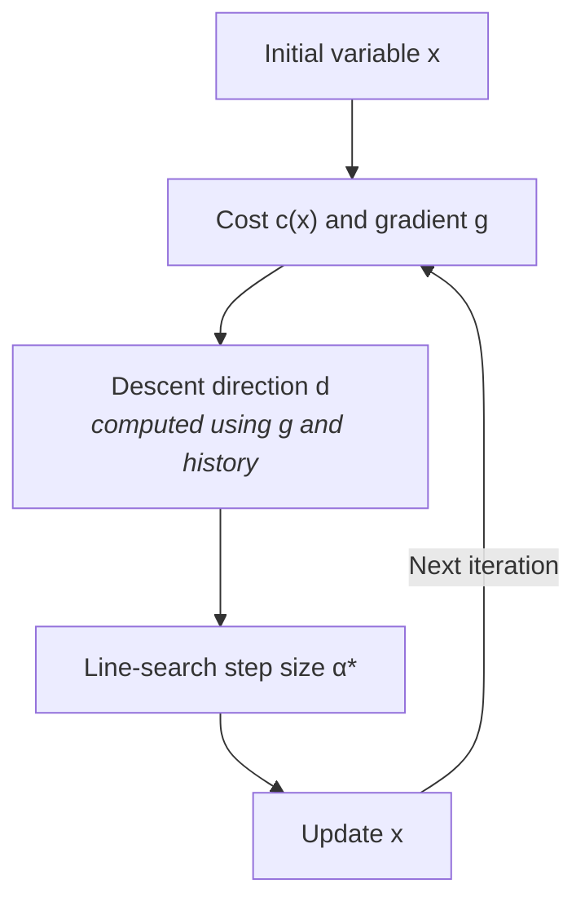

# LBFGSOptimizer

Implements batched [L-BFGS](https://en.wikipedia.org/wiki/Limited-memory_BFGS)
on manifold-valued variables. Source: `src/robokit/opt/lbfgs_optimizer.py`.

## Overview

For the variable $\mathbf{x}$, each iteration computes the cost $c(\mathbf{x})$ and gradient
$\mathbf{g}=\nabla c(\mathbf{x})$. $\mathbf{g}$ and the history give a descent direction
$\mathbf{d}$. With no history, $\mathbf{d}$ follows $-\mathbf{g}$. A line search picks a step
size $\alpha^*$, and $\mathbf{x}$ moves by $\alpha^*\mathbf{d}$.

## Descent direction

The direction $\mathbf{d}$ comes from the gradient $\mathbf{g}$ and a short history of steps.
Iteration $t$, from $\mathbf{x}_t$ to $\mathbf{x}_{t+1}$, adds one history pair:

- $\mathbf{s}_t = \alpha_t^* \mathbf{d}_t$: the tangent step applied to $\mathbf{x}_t$.
- $\mathbf{y}_t = \mathbf{g}_{t+1} - \mathbf{g}_t$: the gradient change from $\mathbf{s}_t$.
  To first order,

  $$
  \mathbf{g}(\mathbf{x}_t+\mathbf{s}_t)
  \approx \mathbf{g}(\mathbf{x}_t)+J_{\mathbf{g}}(\mathbf{x}_t)\mathbf{s}_t.
  $$

  The gradient Jacobian is the cost Hessian,
  $J_{\mathbf{g}}(\mathbf{x})=H(\mathbf{x})=\nabla^2 c(\mathbf{x})$, so
  $\mathbf{y}_t\approx H(\mathbf{x}_t)\mathbf{s}_t$.

[Newton's method](https://en.wikipedia.org/wiki/Newton%27s_method_in_optimization)
uses $\mathbf{d}=-H(\mathbf{x})^{-1}\mathbf{g}$. L-BFGS
replaces the exact inverse with an approximation $A$:

$$
A\approx H(\mathbf{x})^{-1},
\qquad
\mathbf{d}=-A\mathbf{g}.
$$

Below, $i$ indexes the history pairs, oldest first. $A_i$ is the approximation after $i$
pairs, with $A_0=\gamma I$. BFGS adds pair $i$ by

$$
A_{i+1}=V_iA_iV_i^\top+\rho_i \mathbf{s}_i \mathbf{s}_i^\top,
\qquad
V_i=I-\rho_i \mathbf{s}_i \mathbf{y}_i^\top,
\qquad
\rho_i=\frac{1}{\mathbf{y}_i^\top \mathbf{s}_i}.
$$

A pair is used only when $\mathbf{y}_i^\top\mathbf{s}_i>0$; otherwise it is dropped. The
update enforces $A_{i+1}\mathbf{y}_i=\mathbf{s}_i$ and keeps $A_{i+1}$ symmetric positive
definite.

Why does the update work?

1. Why does it enforce $A_{i+1}\mathbf{y}_i=\mathbf{s}_i$?

Since $\rho_i(\mathbf{y}_i^\top \mathbf{s}_i)=1$,
$V_i^\top \mathbf{y}_i=\mathbf{y}_i-\rho_i\mathbf{y}_i
(\mathbf{y}_i^\top \mathbf{s}_i)=\mathbf{0}$. Substituting into the update gives

$$
A_{i+1}\mathbf{y}_i
=V_iA_iV_i^\top \mathbf{y}_i
+\rho_i\mathbf{s}_i(\mathbf{y}_i^\top \mathbf{s}_i)
=\mathbf{0}+\rho_i\mathbf{s}_i(\mathbf{y}_i^\top \mathbf{s}_i)
=\mathbf{s}_i.
$$

2. Why does it stay symmetric positive definite?

Let $A_i$ be symmetric positive definite. Then $V_iA_iV_i^\top$ and
$\rho_i\mathbf{s}_i\mathbf{s}_i^\top$ are symmetric. If
$\mathbf{y}_i^\top\mathbf{s}_i>0$, then $\rho_i>0$, and for any nonzero
$\mathbf{z}$,

$$
\mathbf{z}^\top A_{i+1}\mathbf{z}
=(V_i^\top \mathbf{z})^\top A_i(V_i^\top \mathbf{z})
+\rho_i(\mathbf{s}_i^\top \mathbf{z})^2>0.
$$

So $A_{i+1}$ stays symmetric positive definite.

After all pairs, $A$ approximates $H(\mathbf{x})^{-1}$ and gives $\mathbf{d}=-A\mathbf{g}$.
L-BFGS never builds the $n\times n$ matrix $A$. A two-loop recursion over $m$ history pairs
computes $A\mathbf{g}$ in $O(mn)$ memory and $O(mn)$ operations, where $m\ll n$.

**Normalization.** By default, `normalize_direction=False` keeps the direction's length. Set it
to `True` to scale the direction to unit length before the line search.

How does the matrix update become two loops?

The direction needs $A_m\mathbf{g}$, where $m$ is the number of history pairs. Expanding
$A_m\mathbf{g}$ with the BFGS update gives

$$
\begin{aligned}
A_m\mathbf{g}
&=V_{m-1}A_{m-1}(V_{m-1}^\top\mathbf{g})
+\rho_{m-1}\mathbf{s}_{m-1}
(\mathbf{s}_{m-1}^\top\mathbf{g}) \\
&=V_{m-1}\Big[
V_{m-2}A_{m-2}(V_{m-2}^\top V_{m-1}^\top\mathbf{g})
+\rho_{m-2}\mathbf{s}_{m-2}
(\mathbf{s}_{m-2}^\top V_{m-1}^\top\mathbf{g})
\Big] \\
&\quad+\rho_{m-1}\mathbf{s}_{m-1}
(\mathbf{s}_{m-1}^\top\mathbf{g}) \\
&=\cdots \\
&=V_{m-1}\cdots V_0A_0
(V_0^\top\cdots V_{m-1}^\top\mathbf{g}) \\
&\quad+\cdots+\rho_{m-1}\mathbf{s}_{m-1}
(\mathbf{s}_{m-1}^\top\mathbf{g}).
\end{aligned}
$$

The first loop computes the product $V_0^\top\cdots V_{m-1}^\top\mathbf{g}$. Define
$\mathbf{q}_0=V_0^\top\cdots V_{m-1}^\top\mathbf{g}$. Each step goes from $\mathbf{q}_{i+1}$ to
$\mathbf{q}_i$:

$$
\mathbf{q}_i
=V_i^\top\mathbf{q}_{i+1}
=\mathbf{q}_{i+1}
-\rho_i\mathbf{y}_i(\mathbf{s}_i^\top\mathbf{q}_{i+1}).
$$

Starting from $\mathbf{q}_m=\mathbf{g}$, the loop runs backward from $i=m-1$ to $i=0$ and
yields $\mathbf{q}_0$.

The second loop evaluates the remaining terms, starting from $A_0\mathbf{q}_0$. Define
$\mathbf{r}_0=A_0\mathbf{q}_0=\gamma\mathbf{q}_0$. Each step goes from $\mathbf{r}_i$ to
$\mathbf{r}_{i+1}$:

$$
\mathbf{r}_{i+1}
=V_i\mathbf{r}_i
+\rho_i\mathbf{s}_i(\mathbf{s}_i^\top\mathbf{q}_{i+1})
=\mathbf{r}_i+\rho_i\mathbf{s}_i
(\mathbf{s}_i^\top\mathbf{q}_{i+1}-\mathbf{y}_i^\top\mathbf{r}_i).
$$

Starting from $\mathbf{r}_0$, the loop runs forward from $i=0$ to $i=m-1$ and yields
$\mathbf{r}_m=A_m\mathbf{g}$.

Pseudocode:

$$
\begin{array}{l}
\textbf{input}: \mathbf{g},\ \text{history},\ \gamma \\
\textbf{initialize}: \mathbf{q}_m\leftarrow\mathbf{g} \\
\textbf{for }i=m-1,\ldots,0 \\
\hspace{5mm} \mathbf{q}_i\leftarrow\mathbf{q}_{i+1}
-\rho_i\mathbf{y}_i(\mathbf{s}_i^\top\mathbf{q}_{i+1}) \\
\mathbf{r}_0\leftarrow\gamma\mathbf{q}_0 \\
\textbf{for }i=0,\ldots,m-1 \\
\hspace{5mm} \mathbf{r}_{i+1}\leftarrow\mathbf{r}_i
+\rho_i\mathbf{s}_i
(\mathbf{s}_i^\top\mathbf{q}_{i+1}-\mathbf{y}_i^\top\mathbf{r}_i) \\
\textbf{return}: \mathbf{d}\leftarrow-\mathbf{r}_m
\end{array}
$$

**Initial scale.** The start is $A_0=\gamma I$, with $\gamma$ fixed or adaptive.
[Barzilai-Borwein scaling](https://en.wikipedia.org/wiki/Barzilai%E2%80%93Borwein_method)
picks $\gamma$ from the newest pair $(\mathbf{s}_{m-1},\mathbf{y}_{m-1})$, so
$\gamma\mathbf{y}_{m-1}$ best fits $\mathbf{s}_{m-1}$:

$$
\gamma
=\frac{\mathbf{s}_{m-1}^\top\mathbf{y}_{m-1}}
{\mathbf{y}_{m-1}^\top\mathbf{y}_{m-1}}.
$$

## Line search

The line search tries a fixed set of step sizes $\alpha_j$ at once and picks

$$
\alpha^*
=
\begin{cases}
\displaystyle
\max_j\left\{
\alpha_j
\;\middle|\;
c(\mathbf{x}\oplus\alpha_j\mathbf{d})
\le c(\mathbf{x})+c_1\alpha_j\mathbf{g}^\top\mathbf{d}
\right\},
& \text{if any candidate passes},
\\[3mm]
0,
& \text{otherwise}.
\end{cases}
$$

Since $A$ is positive definite, $\mathbf{g}^\top A\mathbf{g}>0, \mathbf{g}^\top\mathbf{d}<0$. The
[Armijo condition](https://en.wikipedia.org/wiki/Wolfe_conditions)
$c(\mathbf{x}\oplus\alpha_j\mathbf{d})\le
c(\mathbf{x})+c_1\alpha_j\mathbf{g}^\top\mathbf{d}$ requires the actual decrease to be at least
$c_1$ of the predicted first-order decrease. $c_1$ defaults to $10^{-4}$; a larger value
requires more decrease.
